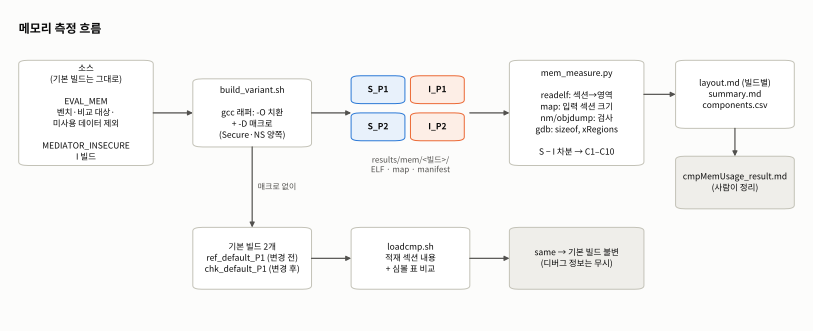
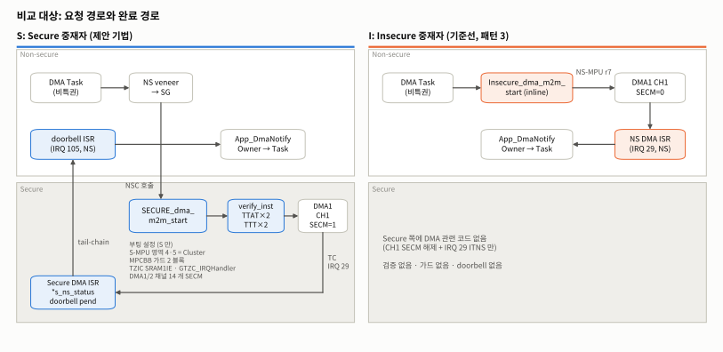
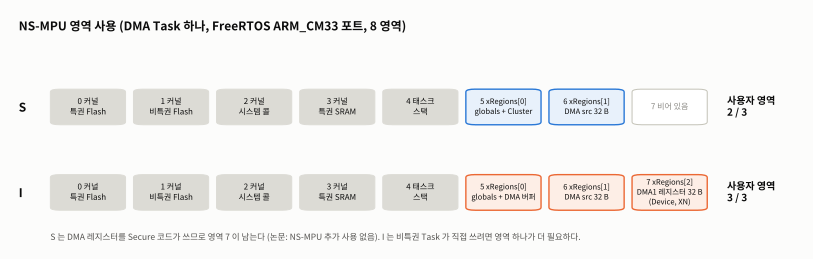
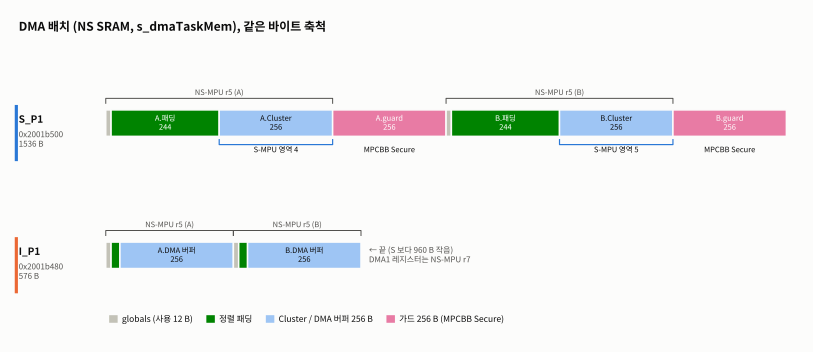
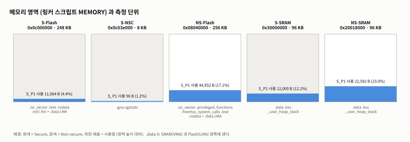
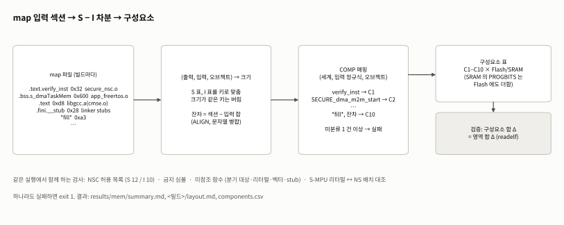

# 메모리 사용량 측정은 어떻게 동작하는가 (S vs I)

작성일 2026-11-22. 이 문서는 **절차와 도구 동작**을 설명한다. 계획은 `cmpMemUsage.md`, 결과는 `cmpMemUsage_result.md`.
측정 중 고친 것과 그 원인은 `cmpMemUsage_result.md` §7 에 모았고, 여기서는 해당 단계에서 번호(M1 등)로 가리킨다.

표기: [코드] 소스·ELF·map 확인 / [도출] 규칙에서 유도 / [추정] 근거 부족 / 미확인.

---

## 0. 전체 흐름



1. 소스에 매크로 두 개(`EVAL_MEM`, `MEDIATOR_INSECURE`)를 넣는다. 매크로가 없는 기본 빌드는 그대로다.
2. `build_variant.sh` 가 매크로·프로파일 조합으로 4 개 빌드(S_P1, I_P1, S_P2, I_P2)를 만들어 `results/mem/` 에 복사한다.
3. `mem_measure.py` 가 ELF 와 map 을 읽어 영역·구성요소별 크기를 내고, 검사를 하고, 표와 빌드별 레이아웃을 쓴다.
4. 아래 줄: 매크로 없이 만든 기본 빌드 두 개(변경 전/후)를 `loadcmp.sh` 로 비교해 기본 빌드가 바뀌지 않았음을 확인한다.
5. `mem_figures.py` 가 같은 ELF/map 에서 그림을 만든다 (§10).

측정은 전부 **정적**이다. 보드에 올리지 않고 링커 산출물(ELF, map)만 읽는다. 보드가 필요한 런타임 항목(힙·스택)은
`cmpMemUsage_result.md` §5 에 절차만 있다.

---

## 1. 무엇과 무엇을 비교하나

| | S (Secure 중재자) | I (Insecure 중재자) |
|---|---|---|
| 정의 | 현재 기본 구현 (논문 §3): Secure NSC 중재자 + `verify_inst` + S-MPU 태그 + MPCBB 가드 + TZIC 중단 + doorbell 통지 | 보호 없이 NS 가 DMA1_CH1 을 직접 설정 (일반 FreeRTOS-MPU 앱의 "패턴 3") |
| 매크로 | `EVAL_MEM` | `EVAL_MEM MEDIATOR_INSECURE` |
| 같게 둔 것 | 태스크 3 개, 8 B M2M, 주기, mutex, `App_DmaNotifyOwner` 통지, 비특권 DMA Task | |



같은 애플리케이션에서 **중재자와 보호 장치만** 다르게 하는 것이 목표다. 그래서 I 는 S 의 코드를 재사용한다:
요청 함수는 `SECURE_dma_m2m_start` 에서 `verify_inst` 와 `s_busy` 를 뺀 것, ISR 은 ISR 벤치의 Insecure 기준선 ISR
(`bench_ns.inc` 의 `DMA1_Channel2_IRQHandler`) 을 CH1 로 옮긴 것이다.

### 1.1 비특권 Task 가 DMA 레지스터에 닿는 방법 (패턴 3)

S 에서는 레지스터를 Secure 코드가 쓰므로 문제가 없다. I 에서는 비특권 Task 가 NS 함수로 직접 쓴다. FreeRTOS 포트는 NS-MPU 를
`PRIVDEFENA` 로만 켜서(`port.c:1007`) 비특권 접근에는 기본 맵이 없다. 그래서 DMA Task 의 비어 있던 `xRegions[2]` (= NS-MPU 영역 7) 에
`0x40020000 + 32 B` (DMA1 ISR, IFCR, CH1 CCR/CNDTR/CPAR/CM0AR/CM1AR) 를 `RW | Device | XN` 으로 준다.
이 영역 하나 때문에 **I 는 NS-MPU 사용자 영역 3/3, S 는 2/3** 을 쓴다. 결과의 NS-MPU 표는 이것을 보여 준다.



---

## 2. 소스에서 무엇이 빠지고 바뀌나

모든 변경은 매크로 안에 있다. 매크로가 없는 기본 빌드는 변경 전과 바이트 단위로 같다 (§6).
원본은 같은 디렉터리의 `*.bak_before_memsuage` 로 남겼다.

### 2.1 `EVAL_MEM` (두 빌드 공통): "실제 코드가 쓰지 않는 것" 제외

`-ffunction-sections -fdata-sections -Wl,--gc-sections` 가 이미 켜져 있어 참조 없는 함수·데이터는 링커가 버린다.
그래도 남는 것은 두 종류다. 매크로는 이 둘만 겨냥한다.

| 남는 이유 | 항목 | 위치 |
|---|---|---|
| NSC 진입점은 sgstub 이 참조하므로 gc 의 뿌리가 된다 | 테이블 방식 `SECURE_dma_m2m_start_table`, `verify_table`, `verify_table_search`, `g_dma_tbl`; 벤치 전용 `SECURE_nop3` | `secure_nsc.c` (`#if 1` → `#if !defined(EVAL_MEM)`), `secure_nsc.h` 선언 |
| 참조는 되지만 값을 아무도 읽지 않는다 | `g_tzic_sr3_at_arm` (init 에서 쓰기만, GDB 감사용) | `secure_nsc.c` |
| 주소만 MPU 설정에 쓰이고 코드는 접근하지 않는다 | `ucPrivateBuffer` (256 B), `ulLookupTable` (512 B, 전부 0), Plain_Task 의 `xRegions` 해당 칸 → `{0,0,0}` | `app_freertos.c` |

BENCH 코드(`bench_*.inc`, `SECURE_bench_*`, CH2 ISR)는 `BENCH_PHASE`/`BENCH_ISR_TS` 를 안 주면 원래 빠진다.



**부작용과 대응 (B1):** `ucPrivateBuffer` 가 `.bss` 에서 `s_dmaTaskMem` 앞에 있어서, 빼면 `s_dmaTaskMem` (`aligned(256)`) 이
0x2001b600 → 0x2001b500 으로 내려간다. Secure `main.c` 는 Cluster 주소를 하드코딩하므로 `EVAL_MEM` 전용 값을 둔다:
A = 0x2001b600. B 는 Task B 수정(878635f) 이후 모든 빌드에서 `A + 0x300` 으로 계산된다 (0x2001b900). 기본 빌드는 A = 0x2001b700, B = 0x2001ba00
(결과 문서 §7.5).

### 2.2 `MEDIATOR_INSECURE` (I 빌드만)

| 파일 | 빠지는 것 (S 에만 있음) | I 에서 대신 들어가는 것 |
|---|---|---|
| `Secure/Src/main.c` | `Secure_DMA_LockAllChannels` (14 채널 SECM), `Secure_TZIC_Init`, `SMPU_SetupTaskRegions`/`SMPU_SetupOneTaskRegion` (+ 그래서 링크되던 `HAL_GTZC_MPCBB_ConfigMemAttributes`) | `__HAL_RCC_DMA1_CLK_ENABLE()`, `DMA1_Channel1->CCR &= ~SECM`, `NVIC_SetTargetState(DMA1_Channel1_IRQn)` (ISR 벤치 CH2 해제와 같은 형식) |
| `Secure/Src/secure_nsc.c` | `verify_inst`, `SECURE_dma_m2m_init/start`, Secure `DMA1_Channel1_IRQHandler`, `GTZC_IRQHandler`, `Secure_TZIC_ArmGuardIrqOnce`, `s_busy`, `s_ns_status` | 없음. `GTZC_IRQHandler` 는 startup 의 weak 기본 핸들러가 된다 (GTZC IRQ 는 켜지지 않음) |
| `Secure_nsclib/secure_nsc.h` | `SECURE_dma_m2m_*` 선언, `SECURE_DMA_DOORBELL_IRQn` | |
| `NonSecure/Src/app_freertos.c` | 가드 256 B, globals 256 B 패딩, `aligned(256)`, `s_dmaStatusWord`, doorbell ISR (`DFSDM1_FLT3_IRQHandler`), doorbell NVIC 설정, DMA Task 의 `portALLOCATE_SECURE_CONTEXT` | globals 32 B (NS-MPU 32 B 단위) + DMA 버퍼 256 B, `aligned(32)`; `Insecure_dma_m2m_init/start`, NS `DMA1_Channel1_IRQHandler`, DMA Task `xRegions[2]` = DMA1 레지스터 |

### 2.3 스크립트 변경

| 파일 | 변경 |
|---|---|
| `scripts/eval/build_variant.sh` | 끝의 배치 검사를 매크로에 따라: `MEDIATOR_INSECURE` 면 생략, `EVAL_MEM` 이면 `LAYOUT_EXPECT=2001b500`, 아니면 기존 0x2001b600 |
| `scripts/eval/check_layout.sh` | 기대 주소를 `LAYOUT_EXPECT` 환경 변수로 받는다 (기본값 2001b600) |
| `scripts/eval/mem_measure.py` | 신규. 측정·검사·문서 생성 (§4) |
| `scripts/eval/loadcmp.sh` | 신규. 두 ELF 의 적재 내용 + 심볼 비교 (§6) |

---

## 3. 빌드: `build_variant.sh` 가 하는 일

```
scripts/eval/build_variant.sh <phase> <variant> <P1|P2> [매크로 ...]
  예) scripts/eval/build_variant.sh mem S_P1 P1 EVAL_MEM
      scripts/eval/build_variant.sh mem I_P1 P1 EVAL_MEM MEDIATOR_INSECURE
```

1. 프로파일 → 최적화 수준: P1 = Secure -O0 / NS -O1 (CubeIDE `Debug` 기본), P2 = 둘 다 -O1.
2. `.build-shim/eval/arm-none-eabi-gcc` 래퍼를 만든다. 커밋된 makefile 은 건드리지 않고, 래퍼가 명령행의 `-O*` 를 바꾸고
   (`-mcmse` 가 있으면 Secure 로 판단) 컴파일(`-c`) 명령에만 `-D<매크로>` 를 붙인다. **Secure 와 NS 양쪽에 같은 매크로**가 들어간다.
   그래서 `secure_nsc.h` 처럼 두 쪽이 공유하는 헤더도 일관된다.
3. `./build.sh clean` 후 `./build.sh` (Secure 먼저, 그 import library `secure_nsc.o` 로 NS 링크).
4. `Debug/` 의 ELF, map, list 를 `results/<phase>/<variant>/` 로 복사하고 `manifest.txt` (매크로, git 커밋, dirty 여부, 컴파일러, sha256, `size`) 를 쓴다.
5. 배치 검사 (§2.3). S 는 NS `s_dmaTaskMem` 주소가 Secure 하드코딩과 맞는 값인지 본다.

주의 (M1): 빌드는 `Debug/` 안에서 일어나므로, 변형 빌드 뒤 `Debug/` 에는 마지막 변형이 남는다. 측정은 항상 `results/` 복사본으로 한다.
작업 끝에는 `./build.sh clean && ./build.sh` 로 `Debug/` 를 기본 빌드로 되돌린다.

`.elf`, `.map`, `.list`, `build.log` 는 `.gitignore` 라 커밋되지 않는다. 다시 만들려면 §7 의 명령을 돌리면 된다 (`manifest.txt` 의 sha256 으로 같은지 확인).

---

## 4. 측정: `mem_measure.py` 가 하는 일

```
python3 -I scripts/eval/mem_measure.py [results/mem]      # 실패 검사가 있으면 exit 1
```
빌드 쌍 (S_P1, I_P1), (S_P2, I_P2) 마다 아래를 한다. 툴체인은 `TOOLCHAIN_BIN` (기본: CubeIDE 2.2.0 의 GCC 14.3.1).

### 4.1 섹션 → 메모리 영역 (`readelf -SW`)



alloc(`A` 플래그) 섹션만 본다. 각 섹션의 VMA 를 링커 스크립트 MEMORY 영역에 넣는다:

| 영역 | 범위 | 들어가는 섹션 |
|---|---|---|
| S-Flash | 0x0C000000 + 248 KB | `.isr_vector .text .rodata .init_array .fini_array` (+ `.data` LMA) |
| S-NSC | 0x0C03E000 + 8 KB | `.gnu.sgstubs` |
| S-SRAM | 0x30000000 + 96 KB | `.data .bss ._user_heap_stack` |
| NS-Flash | 0x08040000 + 256 KB | `.isr_vector .privileged_functions .freertos_system_calls .text .rodata ...` (+ `.data` LMA) |
| NS-SRAM | 0x20018000 + 96 KB | `.data .bss ._user_heap_stack` |

규칙: SRAM 에 있는 PROGBITS 섹션(`.data`)은 초기값 사본이 Flash 에도 있으므로 **양쪽에 센다**. NOBITS(`.bss`, `._user_heap_stack`)는 SRAM 만.
`Flash 합계 = S-Flash + S-NSC + NS-Flash`, `SRAM 합계 = S-SRAM + NS-SRAM`.

### 4.2 입력 섹션 단위 크기 (map 파일)

`-ffunction-sections -fdata-sections` 덕분에 함수·변수가 각자 입력 섹션(`.text.verify_inst`, `.bss.s_dmaTaskMem` 등)이다.
map 의 "Linker script and memory map" 이후를 읽어 `(출력 섹션, 입력 섹션, 오브젝트) → 크기` 표를 만든다.

- 한 줄 형식(` .text.x  0xADDR  0xSIZE obj`)과 두 줄 형식(이름 줄 + 주소/크기/오브젝트 줄)을 모두 읽는다.
- ` *fill*` 줄은 출력 섹션별 정렬 fill 로 모은다.
- 링커가 만든 것: sgstub 은 `.gnu.sgstubs.__stub` (linker stubs), **NS veneer 는 `.text` 안의 `.fini.__stub`** 이라는 이름으로 나온다 (M7).
- 라이브러리 오브젝트는 `libgcc.a(cmse.o)` 처럼 기록한다. 이 경우 입력 섹션 이름이 함수명 없이 `.text` 일 수 있다 (M3).
- **잔차** = 출력 섹션 크기 − 입력 합계. 양수면 맵에 fill 로 안 찍힌 `ALIGN` (예: I 의 `.gnu.sgstubs` 끝 16 B, F2), 음수면 SHF_MERGE
  문자열 병합(맵은 병합 전 크기, M5). 잔차도 차분 대상이다.

### 4.3 S − I 차분과 구성요소 분류



두 빌드의 입력 섹션 표를 키별로 비교해 **크기가 다른 것만** 남긴다. 각 행을 고정 매핑 표(`COMP`, 세계 + 입력 섹션 정규식 + 오브젝트 정규식)로
C1–C10 에 넣는다:

| # | 구성요소 | 매핑 기준 (요지) |
|---|---|---|
| C1 | 요청 검증 | `verify_inst` |
| C2 | 요청 진입점 | `SECURE_dma_m2m_start` |
| C3 | 초기화 | `SECURE_dma_m2m_init`, `Secure_TZIC_ArmGuardIrqOnce`, `cmse_check_address_range`, `secure_nsc.o` 의 NVIC 헬퍼 |
| C4 | 완료 ISR + 통지 | Secure/NS `DMA1_Channel1_IRQHandler`, doorbell ISR, `s_busy`, `s_ns_status`, `s_dmaStatusWord` |
| C5 | 부팅 설정 | `main.o` 의 `main`, `Secure_DMA_LockAllChannels`, `Secure_TZIC_Init`, `SMPU_*`, NVIC 헬퍼, `HAL_GTZC_MPCBB_ConfigMemAttributes` |
| C6 | 전송 시점 보호 | `GTZC_IRQHandler` |
| C7 | 배치 | `s_dmaTaskMem` |
| C8 | NSC 관문 | sgstub, NS veneer |
| C9 | NS 호출부 | `vCreateAppTasks`, `vDmaTaskA/B` (I 는 `Insecure_*` 가 여기 inline, D5) |
| C10 | 정렬 fill | `*fill*`, 잔차 |

- **분류되지 않은 행이 하나라도 있으면 실패**한다. 새 코드가 생기거나 inline 결과가 바뀌어도 조용히 빠지지 않게 하기 위해서다.
- 구성요소 합계 Δ 와 영역 합계 Δ (§4.1) 가 같은지 출력한다. 같아야 모든 차이를 설명한 것이다 (첫 실행의 불일치 468 B 가 M3).
- 출력 섹션이 SRAM 에 있으면 SRAM, PROGBITS 면 Flash 에도 더한다 (§4.1 과 같은 규칙).
- -O0 의 NVIC 헬퍼(`static inline` 이지만 -O0 에서는 함수로 남음)는 오브젝트마다 따로 생긴다. 그래서 같은 이름이 `secure_nsc.o`(C3/C4) 와
  `main.o`(C5) 에 각각 있다. 매핑이 오브젝트까지 보는 이유다.

### 4.4 정적 읽기 (gdb, ELF 만)

`arm-none-eabi-gdb -batch` 로 ELF 의 디버그 정보와 `.rodata` 초기값을 읽는다 (타깃 연결 없음):
`sizeof(dma_task_globals_t)`, `sizeof(dma_task_mem_t)`, `&s_dmaTaskMem`, Cluster 오프셋, `xDmaTaskAParams/xDmaTaskBParams/xPlainTaskParams.xRegions`.
`xRegions` 는 const 초기값이라 보드 없이도 실제 NS-MPU 설정값이다. 포트 규칙(0–3 커널, 4 스택, 5–7 = `xRegions[0..2]`,
`portmacrocommon.h:173-179`)으로 영역 번호를 붙인다. `ulParameters` 비트: 2 = RW, 4 = XN, 16 = Device (`task.h:64-68`).

### 4.5 검사 (하나라도 실패하면 exit 1)

| 검사 | 방법 | 막으려는 것 |
|---|---|---|
| NSC 허용 목록 | `nm` 에서 0x0C03E000–0x0C03FFFF 의 함수 심볼 = S 12 개 / I 10 개 정확히 | 벤치·비교 대상 진입점이 남는 것 |
| 금지 심볼 | `bench`, `verify_table`, `start_table`, `dma_tbl`, `nop3`, `g_tzic_sr3`, `ucPrivateBuffer`, `ulLookupTable`, 강한 `DMA1_Channel2_IRQHandler` | 제외 대상이 남는 것 (정규식을 좁힌 이유 M4) |
| 미참조 함수 | `secure_nsc.o`, `main.o`, `app_freertos.o` 의 모든 함수가 `objdump -d` 의 분기 대상, 적재 섹션의 32 비트 워드(벡터, 함수 포인터, `|1` 포함), NSC stub 의 `__acle_se_` 분기 중 하나에서 참조되는지 | 실행되지 않는 코드가 측정에 섞이는 것 |
| S-MPU 하드코딩 대조 (S 만) | NS 배치에서 계산한 Cluster A/B 주소가 Secure 전체 리터럴 중 `(word & ~0x1F)` (RBAR BASE) 와 일치하는지 | Secure 가 엉뚱한 주소를 태그한 빌드를 재는 것 (-O1 inline 때문에 전체 리터럴을 본다, M6). 기본 빌드에 돌리면 Task B 오류(F1)를 잡는다: 수정 전 B 불일치, 수정 후 일치 |
| 미분류 차이 0 | §4.3 | 설명되지 않은 바이트 |

### 4.6 출력

| 파일 | 내용 |
|---|---|
| `results/mem/<빌드>/layout.md` | 영역별 사용량 막대, 섹션 표(시작/끝/크기/영역 대비), DMA 배치 확대도(globals 사용/패딩, Cluster, guard, S-MPU/MPCBB/NS-MPU 표시), S-MPU 리터럴 대조, NS-MPU 영역 표, NSC 목록, 검사 결과 |
| `results/mem/summary.md` | 프로파일별: 영역 표(Δ, Δ%), 섹션 표, 구성요소 표, 차이 나는 입력 섹션 전체 목록, 검사 |
| `results/mem/components.csv` | `profile,build,component,flash,sram` |

`cmpMemUsage_result.md` 는 이 출력을 사람이 정리한 문서다. 수치를 고치려면 스크립트를 다시 돌리고 문서를 갱신한다.

---

## 5. 지표 정의

| 지표 | 식 | 의미 |
|---|---|---|
| Δ | S − I | 제안 기법이 더하는 바이트 |
| Δ% | (S − I) / I × 100 | 기준선 대비 증가율 (주 지표) |
| Δ / S 전체 | (S − I) / S × 100 | S 메모리 중 보호에 쓰는 몫 |
| 장치 용량 대비 | Δ / 512 KB (Flash), Δ / 256 KB (SRAM) | 칩 전체에서의 비중 |

해석 주의:
- 공통 코드(HAL, FreeRTOS, SecureContext)는 Δ 에서 상쇄되지만 Δ% 의 분모에는 들어간다. 그래서 구성요소 표(§4.3)를 함께 본다.
- Secure 힙(10 KB)·NS 힙(8 KB)·Task 스택은 정적 예약이라 Δ 가 0 이다. 실제 사용량은 런타임 측정(R1–R4)에서만 보인다.
- NSC 영역은 섹션 크기로 센다. stub 수 차이(12 vs 10)는 C8 에, I 의 끝 정렬 16 B 는 C10 에 나타나 서로 상쇄된다 (F2).
- P1 (Secure -O0) 이 기본 빌드 기준값, P2 가 최적화 빌드 대표값이다. 차이의 대부분은 -O0 NVIC 헬퍼와 inline 여부다 (결과 §3.4).

---

## 6. 기본 빌드가 바뀌지 않았는지 확인

1. 소스 수정 **전에** 기본 빌드를 만든다: `scripts/eval/build_variant.sh mem ref_default_P1 P1` (매크로 없음). 이 기준은 fe98482 (측정 코드 넣기 전) 빌드다.
2. 수정 후 같은 명령으로 `chk_default_P1` 을 만든다.
3. `scripts/eval/loadcmp.sh results/mem/{ref,chk}_default_P1/FreeRTOS_SecureIOToggle_TrustZone_{Secure,NonSecure}.elf`.

ELF 파일 자체를 `cmp` 하면 다르다 (M2): `#if` 줄이 행 번호를 바꿔 디버그 정보 크기와 섹션 헤더 오프셋이 달라진다.
`loadcmp.sh` 는 적재되는 바이트(alloc PROGBITS 섹션 내용)와 심볼 표(주소, 크기, 이름)만 비교한다. 이 둘이 같으면 보드에서 실행되는 이미지가 같다 [도출].

**결과의 변화.** 측정 코드 커밋(2a9ad1f) 시점에는 Secure, NS 모두 `same` 이었다. Task B 수정(878635f) 이후에는 의도한 변경이 들어갔으므로
**NS 는 `same`, Secure 는 `DIFF`** 가 정상이다. 그 차이가 의도한 것뿐인지는 이렇게 본다:

```bash
diff <(arm-none-eabi-objdump -d results/mem/ref_default_P1/*_Secure.elf | tail -n +4) \
     <(arm-none-eabi-objdump -d results/mem/chk_default_P1/*_Secure.elf | tail -n +4)     # B 리터럴 3 개만
diff <(arm-none-eabi-objdump -s -j .rodata results/mem/ref_default_P1/*_Secure.elf | tail -n +4) \
     <(arm-none-eabi-objdump -s -j .rodata results/mem/chk_default_P1/*_Secure.elf | tail -n +4)  # g_dma_tbl 항목 6 만
diff <(arm-none-eabi-nm -n -S results/mem/ref_default_P1/*_Secure.elf) <(arm-none-eabi-nm -n -S results/mem/chk_default_P1/*_Secure.elf)  # 없음
```

재측정에서는 측정 빌드 4 개를 수정 전 복사본과 `loadcmp.sh` 로 비교했다 (8/8 `same`). 수치가 바뀌지 않았다는 근거다.

## 7. 처음부터 재현

```bash
cd /home/sysop/dma-tz
# (선택) 변경 전 기준: git stash 또는 *.bak_before_memsuage 로 원복한 트리에서
scripts/eval/build_variant.sh mem ref_default_P1 P1
# 측정 빌드 4 개
for p in P1 P2; do
  scripts/eval/build_variant.sh mem S_$p $p EVAL_MEM                     # → layout ok: s_dmaTaskMem=2001b500
  scripts/eval/build_variant.sh mem I_$p $p EVAL_MEM MEDIATOR_INSECURE   # → layout check skipped
done
# 기본 빌드 불변
scripts/eval/build_variant.sh mem chk_default_P1 P1
for w in Secure NonSecure; do scripts/eval/loadcmp.sh results/mem/{ref,chk}_default_P1/FreeRTOS_SecureIOToggle_TrustZone_$w.elf; done
# 측정 + 문서 생성 (exit 0 이어야 함)
python3 -I scripts/eval/mem_measure.py results/mem
# 그림 (docs/figures/mem/*.svg). FIG_PNG_DIR 을 주면 검토용 PNG 도 쓴다
python3 -I scripts/eval/mem_figures.py results/mem docs/figures/mem
# Debug/ 를 기본 빌드로 되돌림
./build.sh clean && ./build.sh
```

각 빌드의 `manifest.txt` 에 git 커밋과 dirty 상태가 기록된다.

---

## 8. 보드 절차 (미실행)

I 빌드가 실제로 동작하는지(기능 확인)와 런타임 사용량(R1–R5)은 `cmpMemUsage_result.md` §5 의 GDB 명령으로 확인한다. 순서:
1. `results/mem/S_P1` 의 Secure ELF → NS ELF 순으로 플래시 (기존 `scripts/eval` 측정과 같은 방법).
2. 약 60 초 실행 후 정지, §5 표의 "기능" 행 → R1 → R2 → R3 → R4.
3. `I_P1` 로 반복. I 에서는 Secure ISR 이 없으므로 `b DMA1_Channel1_IRQHandler` (NS) 로 완료 경로를 확인한다.
4. 결과는 `cmpMemUsage_result.md` §5 "(측정 후 기입)" 자리에 적는다.

---

## 9. 관련 파일

| 파일 | 역할 |
|---|---|
| `cmpMemUsage.md` | 계획 (목표, 비교 정의, 제외 규칙, 결정 사항) |
| `cmpMemUsage_result.md` | 결과, 측정 중 수정·발견 사항(§7), 전체 측정값(§8) |
| `HowmemUsageWork.md` | 이 문서 |
| `scripts/eval/{build_variant.sh,check_layout.sh,mem_measure.py,loadcmp.sh}` | 빌드·검사·측정 |
| `scripts/eval/mem_figures.py`, `docs/figures/mem/fig01–fig10.svg` | 그림 (§10) |
| `results/mem/` | 빌드 산출물(manifest 만 커밋), `layout.md`, `summary.md`, `components.csv` |
| `docs/gap-analysis.md` G | 논문 밖 기준선, 기본 빌드 Task B 하드코딩 불일치(G-2), 기타 |
| `*.bak_before_memsuage` | 수정 전 원본 (`secure_nsc.c`, `main.c`, `secure_nsc.h`, `app_freertos.c`, `build_variant.sh`, `check_layout.sh`) |

---

## 10. 그림 생성: `mem_figures.py`

```
python3 -I scripts/eval/mem_figures.py [results/mem] [docs/figures/mem]
FIG_PNG_DIR=/path python3 -I scripts/eval/mem_figures.py ...   # 검토용 PNG 사본 (커밋하지 않음)
```

- `mem_measure.py` 를 import 해서 **같은 ELF/map 에서** 수치를 읽는다. 측정을 다시 하면 그림도 다시 만들면 된다. 손으로 적은 수치는 없다.
  주소가 나오는 그림(fig06 배치, fig07 NS-MPU, fig08 Task B)도 nm/gdb 로 읽은 값으로 그린다.
- 차트는 dataviz 지침을 따른다: 가로 막대(기준선 쪽은 각지고 값 쪽 끝 4 px 둥글게), 1 px 가는 격자, 범례 항상 표시, 값은 막대 옆에 직접 표기,
  축 하나 (이중 축 없음). 색은 기준 팔레트 슬롯 순서 그대로: S = 파랑, I = 주황, P1 = 청록, P2 = 노랑, 가드 = 자홍, 패딩 = 초록, fill = 보라.
  Node.js 가 없어 팔레트 검증 스크립트는 이 환경에서 다시 돌리지 못했다 (기준 팔레트 문서의 검증 결과에 의존).
- 정적 SVG 라 hover 는 없다. 대신 모든 그림의 값이 결과 문서 표에 있다. 배경을 밝은 색으로 고정해 GitHub 다크 테마에서도 읽힌다.
- 글꼴: Noto Sans CJK `.ttc` 를 직접 등록하고 SVG 글자는 path 로 저장한다 (M8). 그래서 파일이 50–100 KB 정도다.

| 그림 | 내용 | 쓰는 곳 |
|---|---|---|
| fig01_pipeline | 측정 흐름 | 이 문서 §0 |
| fig02_s_vs_i_paths | S/I 요청·완료 경로 (Secure/NS 구분) | 결과 §2, 이 문서 §1, 계획 §2 |
| fig03_regions | 영역별 사용량 S vs I, P1/P2 | 결과 §1 |
| fig04_components | 구성요소별 Δ Flash / Δ SRAM, P1 vs P2 | 결과 §3.2 |
| fig05_sram_breakdown | SRAM +1096 B 구성 (가드/패딩/fill/변수) | 결과 §3.3 |
| fig06_dma_layout | `s_dmaTaskMem` 배치, NS-MPU/S-MPU/MPCBB 표시 | 결과 §3.6, 이 문서 §2.1, 계획 §2 |
| fig07_nsmpu | DMA Task NS-MPU 8 영역 사용 | 결과 §3.5, 이 문서 §1.1 |
| fig08_taskb_fix | Task B 주소 수정 전/후 | 결과 §7.5 |
| fig09_classify | map → 차분 → 구성요소, 검사 | 이 문서 §4.3 |
| fig10_address_map | 메모리 영역과 섹션, 사용률 | 이 문서 §4.1 |

