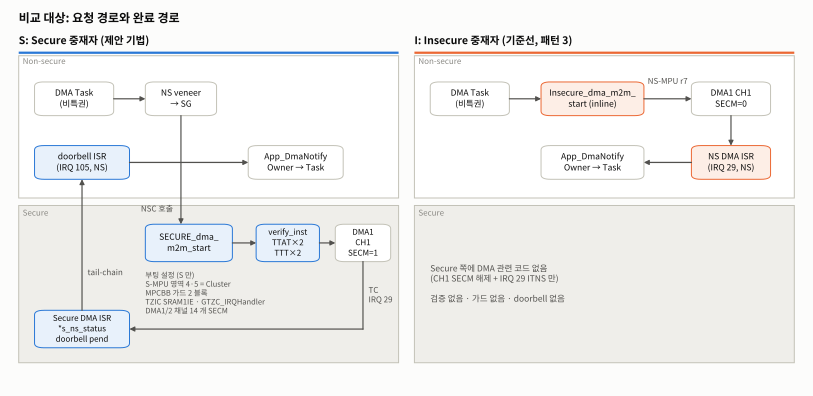
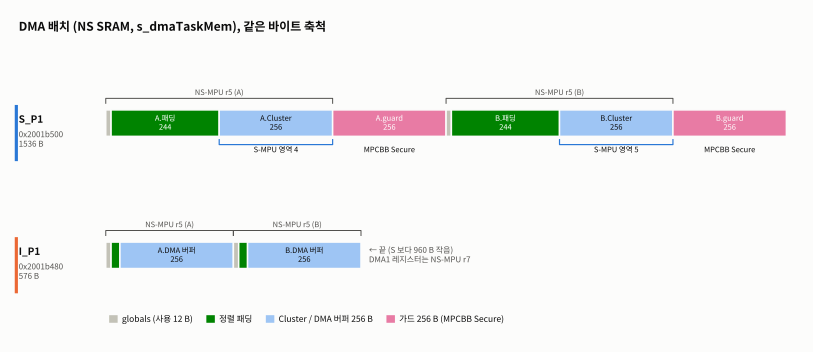

# 메모리(Flash/SRAM) 사용량 비교 계획: Secure 중재자 vs Insecure 중재자

작성일 2026-11-22. **계획 문서**다. 결과는 `cmpMemUsage_result.md`, 측정 절차와 스크립트 동작은 `HowmemUsageWork.md`.

> **2026-11-22 승인·구현 상태:** Q1 = 패턴 3 (비특권 DMA Task + NS-MPU r7 에 DMA1 레지스터 32 B, 특권 Task 아님). Q2, Q3 = 권장안
> (`EVAL_MEM` 에서만 제외). 정적 측정(§6.1–6.4, §7.1) 완료. 런타임(§6.5, R1–R5)과 보드 기능 확인(§7.2)은 2026-11-22 보드 실측 완료
> (결과 §5, 방법 `HowmemUsageWork.md` §11). R3 는 계획과 달리 스택 배열을 직접 덤프하지 않고 `run_runtime.py` 가 긁는다.
> 계획과 달라진 점: (1) `ucPrivateBuffer` 를 빼면 `s_dmaTaskMem` 이 0x2001b500 으로 내려가서 `EVAL_MEM` 전용 Cluster 주소와
> `LAYOUT_EXPECT` 검사를 추가했다. (2) 기본 빌드의 Task B 하드코딩 불일치를 발견했다 (gap G-2, 수정 안 함). (3) 스크립트는
> `mem_measure.py` 하나로 합쳤다 (`mem_layout.py` 없음). (4) 결과의 구성요소는 C1–C10 (C8 = NSC 관문, C9 = NS 호출부, C10 = 정렬 fill).

표기: [논문] docs/paper/paper.txt / [코드] 소스·ELF·map 확인 / [도출] 아키텍처 규칙에서 유도 / [추정] 근거 부족 / 미확인 = 근거 없음.

관련 문서: `Mediator.md`, `cmpTable.md` (사이클), `measureISR_overhead.md` (ISR, 같은 Insecure 기준선 개념),
`scripts/eval/build_variant.sh` (변형 빌드).

---

## 1. 목적과 범위

| 항목 | 내용 |
|---|---|
| 목적 | 제안 기법(Secure 중재자 + S-MPU 태그 + MPCBB 가드 + TZIC 중단)이 더하는 **정적 Flash/SRAM** 과 **런타임 SRAM(힙·스택)** 을, 같은 애플리케이션을 TrustZone 보호 없이 NS 가 DMA 를 직접 설정하는 **Insecure 중재자** 와 비교한다 |
| 산출 | (1) 빌드별 섹션·구성요소 크기 표, (2) 빌드별 메모리 레이아웃 그림, (3) 영역별·구성요소별 차이(바이트, %) |
| 원칙 | **실제로 실행되는 코드와 실제로 읽고 쓰는 데이터만 센다.** 벤치 하니스, 비교 대상(테이블 방식), 감사용 쓰기 전용 변수, 코드가 접근하지 않는 데모 데이터는 두 빌드 모두에서 뺀다 (§3) |
| 범위 밖 | 사이클 (기존 문서). 테이블 방식의 메모리 비용 (필요하면 §10 의 추가 항목으로 따로 잰다). A (BLXNS) 통지 방식 — 기본 구현인 B (doorbell) 만 잰다 |
| 논문과의 관계 | 논문 §5 한계(태스크당 가드 256B + S-MPU 1개) 를 바이트로 확인하는 평가다 [논문]. Insecure 중재자는 논문에 없는 평가용 기준선이다 (ISR 측정의 CH2 기준선과 같은 위치). `docs/gap-analysis.md` 에 G 항목으로 기록한다 |

---

## 2. 비교 대상 정의

### 2.1 두 빌드
| ID | 이름 | 요청 경로 | 완료 경로 | 보호 |
|---|---|---|---|---|
| **S** | Secure 중재자 (현 기본 구현) | NS Task → veneer → `SECURE_dma_m2m_start` (NSC) → `verify_inst` (TTAT x2, TTT x2) → DMA1_CH1 (SECM=1) | Secure `DMA1_Channel1_IRQHandler` → `*s_ns_status`, doorbell pend → NS `DFSDM1_FLT3_IRQHandler` → `App_DmaNotifyOwner` | S-MPU 영역 2개, MPCBB 가드 2블록, TZIC SRAM1IE, `GTZC_IRQHandler` 채널 중단 |
| **I** | Insecure 중재자 (기준선, 신규) | NS Task → NS 함수 `Insecure_dma_m2m_start` → DMA1_CH1 (SECM=0) 레지스터 직접 설정. 검증 없음 | NS `DMA1_Channel1_IRQHandler` → `App_DmaNotifyOwner` (doorbell 없음) | 없음 (NS-MPU 태스크 격리만 공통) |

- 애플리케이션(태스크 3개, 전송 8B M2M, 주기, mutex, 블로킹 통지)은 두 빌드에서 같다. 차이는 **중재자와 보호 장치**뿐이다.
- I 의 레지스터 시퀀스는 `SECURE_dma_m2m_start` 에서 `verify_inst` 와 `s_busy` 만 뺀 것, ISR 본문은 `bench_ns.inc` 의
  Insecure 기준선 ISR(`DMA1_Channel2_IRQHandler`)과 같은 것을 CH1 로 옮긴 것이다 (기존 코드 재사용, 규칙 0).
  `s_busy` 는 Secure 채널이라 생기는 상태로 보고 I 에서 뺀다 (ISR 기준선과 같은 판단, `bench_ns.inc:150`).



### 2.2 구성요소별 대응 (무엇이 S 에만 있는가)
| # | 구성요소 | S | I | 위치 [코드] |
|---|---|---|---|---|
| C1 | 요청 검증 | `verify_inst` (naked, 현 빌드 46B) | 없음 | `secure_nsc.c` |
| C2 | 요청 진입점 | `SECURE_dma_m2m_start` + sgstub 8B + NS veneer 8B | `Insecure_dma_m2m_start` (NS) | `secure_nsc.c` / 신규 NS |
| C3 | 초기화 | `SECURE_dma_m2m_init` (+ `cmse_check_address_range`, `Secure_TZIC_ArmGuardIrqOnce`) + sgstub + veneer | `Insecure_dma_m2m_init` (NS, CCR 설정 + NVIC) | 〃 |
| C4 | 완료 ISR | Secure ISR (현 80B) + NS doorbell ISR + `s_dmaStatusWord`, `s_ns_status`, `s_busy` | NS DMA ISR 1개 | `secure_nsc.c`, `app_freertos.c` |
| C5 | 부팅 설정 | `Secure_DMA_LockAllChannels`, `Secure_TZIC_Init`, `SMPU_SetupTaskRegions`/`SMPU_SetupOneTaskRegion`, 이로 인해 링크되는 `HAL_GTZC_MPCBB_ConfigMemAttributes` (현 304B) | CH1 `SECM` 해제 + `NVIC_SetTargetState(DMA1_Channel1_IRQn)` 만 | Secure `main.c` |
| C6 | 전송 시점 보호 | `GTZC_IRQHandler` (현 36B) | 없음 (기본 weak 핸들러) | `secure_nsc.c` |
| C7 | 배치 (NS SRAM) | `dma_task_mem_t` = globals 256B(패딩) + Cluster 256B + **guard 256B**, `aligned(256)`, 태스크당 768B | globals(실제 크기, 32B 정렬) + dst 256B, `aligned(32)` | `app_freertos.c` |
| C8 | NS 쪽 통지 설정 | doorbell `NVIC_SetPriority/EnableIRQ` | DMA1_CH1 IRQ 우선순위/Enable | `vCreateAppTasks` |
| C9 | Secure context (런타임) | DMA Task 2개가 `portALLOCATE_SECURE_CONTEXT` → Secure 힙에서 각 1024B 스택 + 컨텍스트 | DMA Task 는 NSC 를 부르지 않으므로 할당 안 함. Plain_Task 는 `SECURE_LEDToggle` 때문에 두 빌드 모두 할당 | `app_freertos.c` |
| C10 | 하드웨어 자원 (바이트 아님) | S-MPU 영역 2/8, MPCBB 블록 2, IRQ 라인 1 (doorbell), Secure DMA 채널 | 없음 | §6.4 에 표로만 기록 |



C7 의 I 배치 근거: NS-MPU (ARMv8-M) 영역은 base/limit 32B 정렬이면 된다 [도출]. globals 를 256B 로 채운 것과
`aligned(256)` 은 가드(MPCBB 256B 블록) 정렬 때문이므로 [코드 주석, app_freertos.c:105] 보호가 없는 I 에는 필요 없다.

---

## 3. "쓸모없는 코드·데이터" 제외 규칙

`-ffunction-sections -fdata-sections -Wl,--gc-sections` 가 이미 켜져 있어 참조 없는 일반 함수·데이터는 빠진다 [코드: makefile 67행].
문제는 **gc 의 뿌리로 남는 것**과 **참조는 되지만 실제로는 쓰지 않는 것**이다.

### 3.1 현재 기본 빌드에 남아 있는 것 (현 ELF 의 sgstub 목록 확인 [코드])
| 항목 | 남는 이유 | 실제 사용 | 조치 |
|---|---|---|---|
| `SECURE_dma_m2m_start_table`, `verify_table`, `verify_table_search`, `g_dma_tbl` (64B) | NSC 진입점은 sgstub 이 참조하므로 gc 되지 않음 (`#if 1`) | 벤치에서만 호출 | `EVAL_MEM` 에서 제외 |
| `SECURE_nop3` | NSC 진입점, 무조건 컴파일 | `bench_ns.inc`, `main.c` 의 `#if 0` 안에서만 호출 | `EVAL_MEM` 에서 제외 (또는 영구히 `BENCH_PHASE` 로 이동 — §8 Q2) |
| `g_tzic_sr3_at_arm` (4B) | 전역, init 에서 씀 | 쓰기 전용 감사 변수. 어떤 코드도 읽지 않음 (GDB 로만 확인) | `EVAL_MEM` 에서 쓰기와 정의 제외 |
| `ucPrivateBuffer` (256B .bss), `ulLookupTable` (512B .rodata, 전부 0) | Plain_Task 의 `xRegions` 가 주소를 참조 | 어떤 코드도 읽거나 쓰지 않음 | 두 빌드 모두 `EVAL_MEM` 에서 제외, xRegions 해당 칸은 `{0,0,0}` |
| `bench_*`, `g_benchT1/T4`, `SECURE_bench_*`, CH2 ISR | `BENCH_PHASE`/`BENCH_ISR_TS` 빌드 전용 | — | 두 빌드 모두 해당 매크로 없이 빌드 (현 `Debug/` ELF 는 벤치 빌드 산출물이라 쓰지 않는다) |
| `DMA_NOTIFY_BLXNS` 경로 | 매크로 빌드 전용 | — | 정의하지 않음 |
| `*.c_bak*` | makefile 에 없음 | — | 영향 없음 |

공통 코드(HAL, FreeRTOS 커널, `SECURE_LEDToggle`, `SECURE_RegisterCallback`, `SECURE_SystemCoreClockUpdate`, SecureContext_*)
는 두 빌드에 똑같이 들어가 차이에서는 상쇄된다. 다만 % 의 분모가 되므로 §6.3 에서 "중재자 관련분만" 의 % 도 따로 낸다.

### 3.2 제외 방법
- 새 매크로 **`EVAL_MEM`** 하나로 위 항목을 뺀다. 기본 빌드와 기존 사이클 측정 빌드는 바뀌지 않는다
  (`cmpTable.md`, `Mediator.md` 재현성 유지). 기존 `#if 1 /* table-search comparison */` 은 `#if !defined(EVAL_MEM)` 로 바꾸고,
  `secure_nsc.h` 의 선언도 같은 조건으로 감싼다.
- 새 매크로 **`MEDIATOR_INSECURE`** 로 I 빌드를 만든다 (§4). Secure·NS 양쪽 컴파일에 같이 붙는다 (`build_variant.sh` 의 `EVAL_DEFS`).

### 3.3 제외 검증 (스크립트가 자동으로 실패시킴)
1. **NSC 허용 목록**: S 의 `.gnu.sgstubs` 심볼이 정확히
   `SecureContext_{Init,AllocateContext,FreeContext,LoadContext,SaveContext}`, `SecureInit_{DePrioritizeNSExceptions,EnableNSFPUAccess}`,
   `SECURE_{SystemCoreClockUpdate,RegisterCallback,LEDToggle,dma_m2m_init,dma_m2m_start}` 12개여야 한다.
   I 는 `SECURE_dma_m2m_*` 2개를 뺀 10개.
2. **금지 심볼 0개**: `nm` 결과에 `bench|table|tbl|nop3|g_tzic_sr3|ucPrivateBuffer|ulLookupTable|DMA1_Channel2_IRQHandler(강한 심볼)` 이 없어야 한다.
3. **도달성 확인**: S/I 각각에서 중재자 관련 오브젝트(`secure_nsc.o`, `main.o`, `app_freertos.o`)의 모든 정의 심볼이
   다른 코드에서 참조되거나(objdump 재배치 / 리스팅 `bl` 대상) 벡터 테이블·sgstub 에 있어야 한다. 아니면 목록으로 출력하고 실패.
4. map 의 `Discarded input sections` 에 중재자 관련 함수가 있으면 그것은 이미 빠진 것이므로 표에 넣지 않는다.

---

## 4. Insecure 중재자 구현 계획 (승인 후)

| 파일 | 변경 (`#if defined(MEDIATOR_INSECURE)` 안에서만) |
|---|---|
| `Secure/Src/main.c` | `Secure_DMA_LockAllChannels`, `Secure_TZIC_Init`, `SMPU_SetupTaskRegions` 호출 제외. 대신 `DMA1_Channel1->CCR &= ~DMA_CCR_SECM; NVIC_SetTargetState(DMA1_Channel1_IRQn);` (ISR 벤치의 CH2 해제 코드와 같은 형식, `main.c:134`). 함수 정의도 같은 조건으로 감싼다 (static 이라 미호출이면 경고만 나므로) |
| `Secure/Src/secure_nsc.c` | `verify_inst`, `SECURE_dma_m2m_init/start`, `DMA1_Channel1_IRQHandler`, `GTZC_IRQHandler`, `Secure_TZIC_ArmGuardIrqOnce`, 관련 static 변수 제외 |
| `Secure_nsclib/secure_nsc.h` | `SECURE_dma_m2m_*`, `SECURE_DMA_DOORBELL_IRQn` 제외. `Insecure_dma_m2m_init/start` 선언은 NS 헤더(`main.h`) 쪽 |
| `NonSecure/Src/app_freertos.c` | `dma_task_mem_t` 를 I 배치로 (globals 실제 크기 + dst 256B, `aligned(32)`, guard 없음). `Insecure_dma_m2m_init/start`, NS `DMA1_Channel1_IRQHandler` (= 기준선 ISR 본문, `App_DmaNotifyOwner` 재사용). `s_dmaStatusWord`, doorbell ISR, doorbell NVIC 설정 제외. DMA Task 의 `portALLOCATE_SECURE_CONTEXT` 제외 (NSC 를 안 부르므로) |
| `scripts/eval/check_layout.sh` | I 는 배치가 달라 `0x2001b600` 검사를 건너뛴다 (인자 또는 `MEDIATOR_INSECURE` 감지) |

**권한 문제 (결정: 패턴 3)**: DMA Task 는 비특권이다. FreeRTOS MPU 포트에서 비특권 Task 는 DMA1 레지스터(0x40020000)에
접근할 수 없다 [도출: NS-MPU 가 켜져 있고 비특권에는 기본 맵이 없음]. 선택지:
- (채택, 패턴 3) NS-MPU 비어 있는 `xRegions[2]` (= r7) 에 DMA1 ISR/IFCR + CH1 레지스터 32 B 를 Device/RW/XN 으로 매핑. Task 권한과 커널 호출 경로가 S 와 같다.
  CLAUDE.md 의 "NS-MPU 영역 추가 사용 금지" 는 제안 기법(S)에 대한 것이고, 이 영역은 I 기준선에만 있다 (gap G-1). NS-MPU 사용 수는 결과에 따로 적는다.
- (기각) DMA Task 를 특권으로 생성: 비특권 Task 의 시스템 콜 경로(`configSYSTEM_CALL_STACK_SIZE` 스택)를 타지 않아 런타임 스택 비교가 달라지고, Task 전체의 격리가 사라진다.
- 두 방법 모두 정적 메모리 크기는 같다 (비트 1개 / 이미 있는 xRegions 칸) [도출]. 그래서 결과 수치에는 영향이 없고, 기능 확인 방법만 달라진다.

I 빌드는 기능적으로 실제 동작해야 한다 (§7.2 에서 보드 확인). 동작하지 않는 기준선의 크기는 의미가 없다.

---

## 5. 빌드 매트릭스

| 빌드 | 명령 | 프로파일 |
|---|---|---|
| S-P1 | `scripts/eval/build_variant.sh mem S_P1 P1 EVAL_MEM` | Secure -O0, NS -O1 (현 Debug 기본) |
| I-P1 | `scripts/eval/build_variant.sh mem I_P1 P1 EVAL_MEM MEDIATOR_INSECURE` | 〃 |
| S-P2 | `scripts/eval/build_variant.sh mem S_P2 P2 EVAL_MEM` | Secure -O1, NS -O1 |
| I-P2 | `scripts/eval/build_variant.sh mem I_P2 P2 EVAL_MEM MEDIATOR_INSECURE` | 〃 |

- 주 결과는 P1 (기본 빌드). P2 는 Secure 최적화가 코드 크기에 주는 영향을 보는 보조 결과다.
  `verify_inst` 는 naked asm 이라 프로파일과 무관하게 같은 크기여야 한다 (교차 확인 항목).
- 산출물: `results/mem/<빌드>/{*.elf,*.map,*.list,manifest.txt}` (기존 `build_variant.sh` 그대로).
- 빌드 4개 모두 `./build.sh` 경고 수가 기본 빌드보다 늘지 않아야 한다.

---

## 6. 측정 항목

### 6.1 정적 크기 (보드 불필요)
`arm-none-eabi-size -A` 섹션 값을 아래처럼 묶는다. `.data` 는 Flash(LMA)와 SRAM 양쪽에 센다.

| 영역 | 포함 섹션 |
|---|---|
| Secure Flash | `.isr_vector .text .rodata .ARM* .init_array .fini_array .data(LMA)` |
| Secure NSC Flash | `.gnu.sgstubs` (8B x 진입점 수) |
| Secure SRAM | `.data .bss ._user_heap_stack` (`.bss` 안의 Secure 힙 `ucHeap` 10240B 는 따로 표시) |
| NS Flash | `.isr_vector .privileged_functions .freertos_system_calls .text .rodata .ARM* .init_array .fini_array .data(LMA) .guard_table` |
| NS SRAM | `.data(ucHeap 8192B 포함) .bss ._user_heap_stack` |

추가로 정렬 낭비를 따로 센다: S 의 `dma_task_mem_t` 내부 패딩 (globals 256B − `sizeof(dma_task_globals_t)`) 과
`aligned(256)` 때문에 `s_dmaTaskMem` 앞에 생긴 fill (map 의 `*fill*`), I 의 32B 정렬 fill.

### 6.2 구성요소별 크기 (보드 불필요)
§2.2 의 C1–C8 각각을 `nm -S` 심볼 크기 합으로 낸다. 심볼→구성요소 매핑은 스크립트 안에 고정 표로 두고,
§3.3-3 의 도달성 검사에서 매핑되지 않은 중재자 오브젝트 심볼이 있으면 실패시킨다 (빠뜨린 항목 방지).
NS veneer (`__SECURE_*_veneer`) 와 sgstub 도 C2/C3 에 포함한다.

### 6.3 차이와 % (보드 불필요)
각 영역과 합계에 대해:
- Δ = S − I (바이트)
- Δ% = (S − I) / I × 100 — **기준선 대비 증가율** (주 지표)
- 장치 용량 대비 = Δ / 용량 × 100 (Flash 512KB, SRAM 256KB [코드: .ld 주석]) — 참고 지표
- **중재자 관련분만의 %**: 공통 코드를 뺀 C1–C8 합 기준. 분모가 커서 % 가 작아 보이는 착시를 막는다.

합계 행: Flash 합계 (Secure + NSC + NS), SRAM 합계 (Secure + NS), SRAM 중 `s_dmaTaskMem` 기여(C7).
C7 은 다시 **가드 512B** / **정렬 패딩** / 나머지로 나눠 논문 §5 의 "태스크당 가드 256B" 와 대조한다 [논문].

### 6.4 하드웨어 자원 (표로만)
| 자원 | S | I | 한도 |
|---|---|---|---|
| S-MPU 영역 | 2 (태스크당 1) | 0 | 8 [논문] |
| MPCBB 블록 (Secure 로 전환) | 2 (512B) | 0 | — |
| NS-MPU 영역 | 태스크당 2 (공통) | 같음 | — |
| IRQ 라인 | DMA1_CH1 (Secure) + doorbell 105 (NS) | DMA1_CH1 (NS) | — |
| DMA 채널 보안 속성 | CH1–7 x 2 SECM=1 | CH1 SECM=0 | — |

### 6.5 런타임 SRAM (보드 필요, 보조)
정적 예약(`ucHeap`, Task 스택 배열)은 두 빌드가 같으므로 **실제 사용량**을 따로 잰다.

| ID | 항목 | 방법 |
|---|---|---|
| R1 | Secure 힙 사용량 | GDB: `secure_heap.c` 의 `xFreeBytesRemaining`, `xMinimumEverFreeBytesRemaining` (Secure ELF 심볼). 기대: S 가 I 보다 Secure context 2개분 (2 x (1024 + 헤더)) 더 씀 [도출] |
| R2 | NS FreeRTOS 힙 사용량 | GDB: NS `xFreeBytesRemaining`, `xMinimumEverFreeBytesRemaining`. 두 빌드 같을 것으로 [추정] |
| R3 | NS Task 스택 최대 사용 | GDB: `uxTaskGetStackHighWaterMark` 대신 TCB 의 스택 영역을 `0xa5` 채움 기준으로 스캔 (`configCHECK_FOR_STACK_OVERFLOW=2` 이므로 채움이 있음 [코드: FreeRTOSConfig.h:81]) |
| R4 | Secure 스택 최대 사용 | Secure context 스택 (Task 별, Secure 힙 안) 과 MSP_S. 부팅 직후 GDB 로 영역을 패턴으로 채우고 일정 시간 실행 후 스캔 |
| R5 | 정적 스택 추정 | `-fstack-usage` 의 `.su` (이미 생성됨): `SECURE_dma_m2m_start`, Secure ISR, NS ISR, `Insecure_dma_m2m_start`. 보드 없이 R3/R4 의 교차 확인 |

측정 시점: 부팅 후 DMA Task A/B 가 각 100회 이상 전송한 뒤 (Task A 500ms 주기 → 약 60초). 실행 시간은 결과에 기록.

---

## 7. 메모리 레이아웃 그림

### 7.1 생성
새 스크립트 `scripts/eval/mem_layout.py <빌드 디렉터리>` 가 ELF (`readelf -S`, `nm -S -n`) 와 map 을 읽어
빌드마다 `results/mem/<빌드>/layout.md` 를 만든다. 내용:

1. **주소 맵 (영역별 막대)** — Secure Flash `0x0C000000`, NSC `0x0C03E000`, Secure SRAM `0x30000000`,
   NS Flash `0x08040000`, NS SRAM `0x20018000`. 섹션마다 시작·끝·크기·영역 대비 % 를 ASCII 막대로.
2. **중재자 상세 표** — C1–C8 각 심볼의 주소, 크기, 섹션.
3. **DMA 배치 확대도** — `s_dmaTaskMem` 을 256B 눈금으로:
   ```
   S:  0x2001b600 [A.globals 256 (사용 nnB + 패딩)] [A.Cluster 256 | S-MPU 4] [A.guard 256 | MPCBB Secure]
                  [B.globals 256] [B.Cluster 256 | S-MPU 5] [B.guard 256 | MPCBB Secure]
   I:  0x2001xxxx [A.globals nn][A.dst 256][B.globals nn][B.dst 256]
   ```
   S 에는 NS-MPU 영역(globals+Cluster), S-MPU 영역, MPCBB 블록을 겹쳐 표시하고, Secure `main.c` 하드코딩 주소와 일치하는지 같이 찍는다.
4. 다른 빌드 대비 이동한 심볼 목록 (S↔I 같은 프로파일끼리).

그림은 텍스트(마크다운 + ASCII)로 만든다. 커밋에 그대로 남고 diff 로 비교할 수 있다.
요약 그림(4 빌드 나란히, 영역별 누적 막대)은 `results/mem/summary.md` 에 같은 형식으로 둔다.

### 7.2 기능 확인 (보드, 측정 전 필수)
레이아웃이 맞아도 동작하지 않으면 측정하지 않는다.

| 빌드 | 확인 | GDB |
|---|---|---|
| S | Task A Cluster 에 전송이 반복됨, 가드 MPCBB Secure, S-MPU 영역 4/5 | `x/8xb &s_dmaTaskMem[0].cluster.dst` (0x2001b700, 0x00..0x07) ; `p s_dmaTaskMem[0].globals.v` 로 `dmaDone=1, dmaStatus=0` ; Secure MPU: `set *(uint32_t*)0xE000ED98=4` 후 `x/2xw 0xE000ED9C` = `0x2001b703 0x2001b7e1` (RBAR/RLAR, `SMPU_SetupOneTaskRegion` 값에서 도출) |
| I | 같은 전송이 반복됨, CH1 SECM=0, IRQ 29 ITNS=1 | `x/8xb &s_dmaTaskMem[0].dst` ; `p/x DMA1_Channel1->CCR` 의 bit17(SECM)=0 ; `p/x NVIC->ITNS[0]` bit29=1 [코드: ITNS 비트 위치는 IRQ 번호 기준, RM0438 절 번호 미확인] |
| 둘 다 | Task B 도 전송, Plain_Task LED 토글 | `b App_DmaNotifyOwner` 가 두 Task 번갈아 걸림 ; LED10 깜빡임 |

(UART 출력은 현재 앱에 없다. 위 GDB 확인으로 대신한다.)

---

## 8. 결정이 필요한 것 (승인 시 답변 요청)

| # | 질문 | 권장 |
|---|---|---|
| Q1 | I 빌드에서 비특권 DMA Task 의 DMA 레지스터 접근: 특권 Task / NS-MPU 영역 2 에 DMA1 매핑 | **결정: NS-MPU 매핑 (패턴 3)**. 크기 영향 없음 (§4) |
| Q2 | `SECURE_nop3` (벤치 전용): `EVAL_MEM` 에서만 뺄지, 영구히 `BENCH_PHASE` 안으로 옮길지 | `EVAL_MEM` 에서만 (기본 빌드·기존 측정 불변) |
| Q3 | `ucPrivateBuffer`/`ulLookupTable` 를 Plain_Task 격리 시연용으로 보고 남길지 | 뺀다 (코드가 접근하지 않음, 요청 조건). 두 빌드 공통이라 Δ 는 불변, % 분모만 바뀜 |

---

## 9. 결과 (→ `cmpMemUsage_result.md`. 아래 빈 표는 계획 당시 형식)

### 9.1 영역별 (P1)
| 영역 | S (B) | I (B) | Δ (B) | Δ% (대 I) | 용량 대비 |
|---|---|---|---|---|---|
| Secure Flash | | | | | |
| Secure NSC | | | | | |
| Secure SRAM | | | | | |
| NS Flash | | | | | |
| NS SRAM | | | | | |
| **Flash 합계** | | | | | /512KB |
| **SRAM 합계** | | | | | /256KB |

### 9.2 구성요소별 (P1)
| # | 구성요소 | S | I | Δ |
|---|---|---|---|---|
| C1 | 요청 검증 | | 0 | |
| C2 | 요청 진입점 (+sgstub, veneer) | | | |
| C3 | 초기화 | | | |
| C4 | 완료 ISR + 통지 | | | |
| C5 | 부팅 설정 | | | |
| C6 | 전송 시점 보호 | | 0 | |
| C7 | 배치: 가드 / 패딩 / 나머지 | | | |
| C8 | NS 통지 설정 | | | |
| | **중재자 관련 합계와 %** | | | |

### 9.3 P2, 런타임 (R1–R5), 레이아웃 그림 링크
(측정 후)

---

## 10. 작업 순서와 커밋

| 단계 | 내용 | 검증 | 커밋 (CHANGES.md 한 줄) |
|---|---|---|---|
| 1 | `EVAL_MEM` 제외 매크로 (§3.2) | 기본 빌드 ELF·리스팅이 이전과 동일 (`cmp`), `EVAL_MEM` 빌드에서 §3.3-1,2 통과 | §4 평가, 기존 코드 조건부 제외 |
| 2 | `MEDIATOR_INSECURE` 구현 (§4), `check_layout.sh` | 4 빌드 성공, 기본 빌드 불변, `docs/gap-analysis.md` G 기록 | §4 평가(논문 밖 기준선), 기존 기준선 ISR 재사용 + 신규 |
| 3 | `scripts/eval/mem_measure.py` (§6.1–6.3, §3.3 검사), `mem_layout.py` (§7) | 현 빌드로 수동 `size`/`nm` 값과 스크립트 값 일치 | 스크립트 신규 |
| 4 | 정적 결과 4 빌드 → `results/mem/`, §9.1/9.2 기입 | §3.3 전부 통과 | 측정 결과 (보드 불필요) |
| 5 | 보드: §7.2 기능 확인 → R1–R4 | 사용자 보드 실행 | 측정 결과 (보드 실측) |

선택 항목 (요청 시만): 테이블 방식 빌드(T)의 메모리 (`g_dma_tbl` 64B + 탐색 코드 − TTT 대비), S-MPU 영역 대신 테이블을 쓸 때의 Flash 비용.
