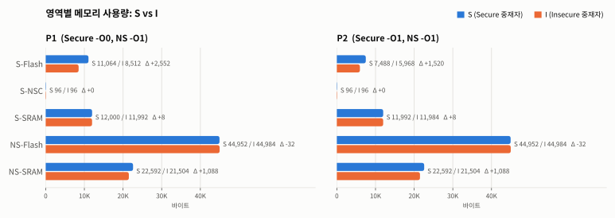
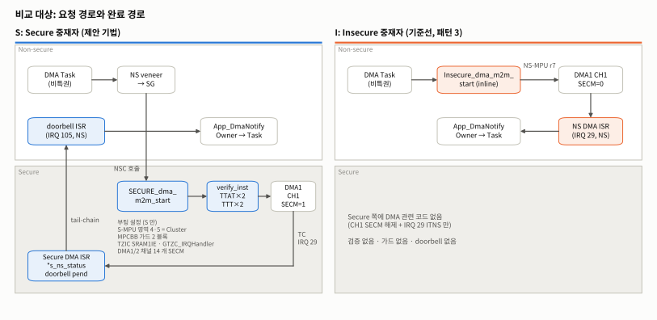
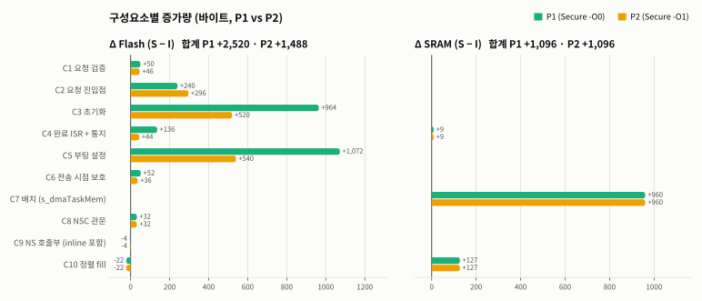
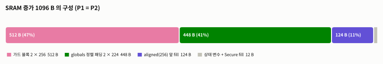
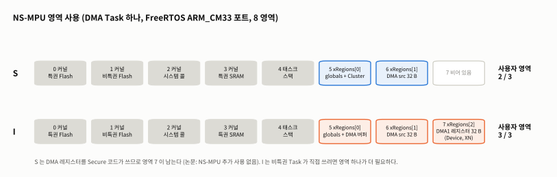
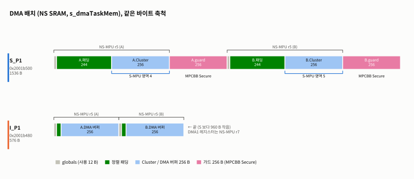
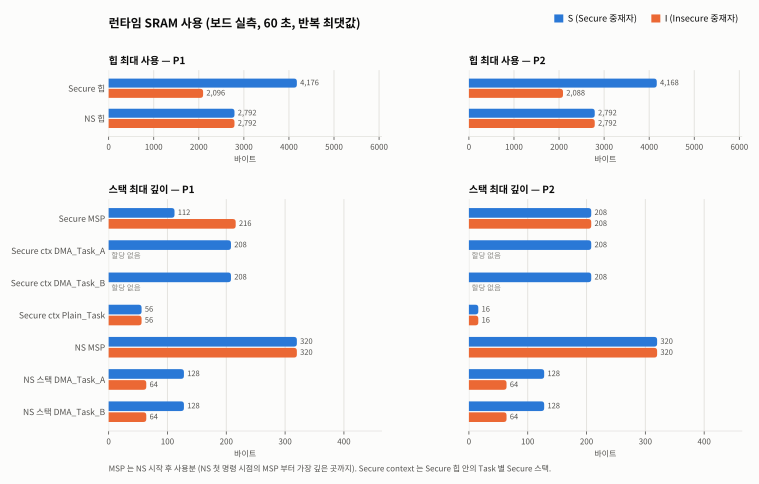
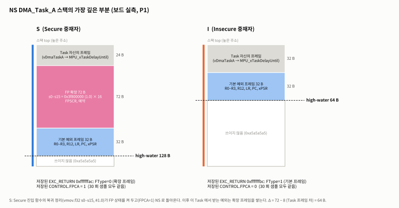
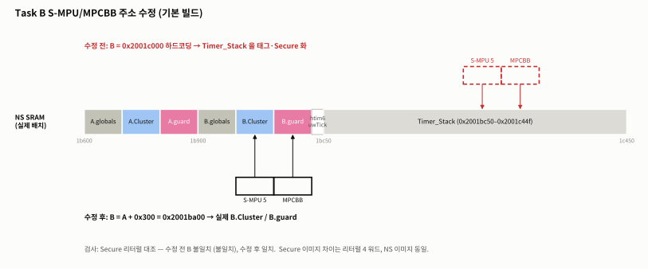

# 메모리(Flash/SRAM) 사용량: Secure 중재자 (S) vs Insecure 중재자 (I)

작성일 2026-11-22. **정적 측정** (ELF/map, 보드 불필요). 런타임 힙·스택(R1–R5)은 보드 측정 전이라 §5 에 절차만 둔다.
- 계획: `cmpMemUsage.md`. 측정 방법과 스크립트 동작: `HowmemUsageWork.md`.
- 원자료: `results/mem/<빌드>/{*.elf,*.map,manifest.txt}` (빌드 4개: `S_P1`, `I_P1`, `S_P2`, `I_P2`), 빌드별 레이아웃 `results/mem/<빌드>/layout.md`.
- 집계: `python3 -I scripts/eval/mem_measure.py results/mem` → `results/mem/summary.md`, `results/mem/components.csv`.

- 그림: `docs/figures/mem/*.svg`, `python3 -I scripts/eval/mem_figures.py results/mem docs/figures/mem` 로 같은 ELF/map 에서 생성.
  색은 dataviz 기준 팔레트의 검증된 슬롯 순서(S 파랑·I 주황, P1 청록·P2 노랑)를 그대로 썼다. 이 환경에는 Node.js 가 없어 팔레트 검증 스크립트를 다시 돌리지는 못했다.
  모든 그림의 수치는 바로 옆 표에도 있다.

측정 코드: `EVAL_MEM` (벤치·비교 대상·미사용 데이터 제외), `MEDIATOR_INSECURE` (I 빌드). 둘 다 기본 빌드에는 영향이 없다 (§4).

> **재측정 (2026-11-22, 커밋 878635f, Task B 주소 수정 후).** 같은 방법(§4, `HowmemUsageWork.md` §7)으로 4 빌드를 다시 만들고 측정했다.
> 4 빌드 모두 수정 전 빌드와 적재 내용·심볼이 **동일**하다 (`loadcmp.sh`, 8/8 same). `EVAL_MEM` 빌드는 처음부터 자기 배치에 맞는 Task B 주소를
> 썼기 때문이다. 그래서 이 문서의 수치는 그대로이고 `summary.md` 도 바이트 단위로 같다. 바뀐 것은 기본 빌드뿐이다 (§7.5).

표기: [실측] 보드 측정 / [논문] docs/paper/paper.txt / [코드] 소스·ELF·map 확인 / [도출] 값 간 계산 / [추정] 근거 부족.
단위는 바이트. Δ = S − I, Δ% = (S − I) / I × 100.

## 1. 요약

- **Flash +2520 B (+4.70 %), SRAM +1096 B (+3.27 %)** (P1 = 기본 프로파일, Secure -O0 / NS -O1) [코드].
  장치 용량 대비 Flash 0.48 %, SRAM 0.42 %.
- P2 (Secure -O1) 에서는 **Flash +1488 B (+2.91 %)**, SRAM 은 같다 (+1096 B). P1 대비 Flash Δ 가 1032 B (41 %) 줄고, 그중 688 B 는
  Secure -O0 이 static inline NVIC 헬퍼를 오브젝트마다 따로 만드는 비용이다 (§3.4) [코드].
- 늘어나는 Flash 는 거의 전부 Secure 쪽이다: **S-Flash +2552 B (+29.98 %)**. NS-Flash 는 오히려 −32 B (NS 가 DMA ISR 을 직접 하지 않으므로) [코드].
- 요청 경로의 고유 코드는 작다: `verify_inst` 50 B + `SECURE_dma_m2m_start` 240 B + 관문 32 B. 가장 큰 것은 부팅 설정(C5, +1072 B, 그중
  `HAL_GTZC_MPCBB_ConfigMemAttributes` 492 B)과 초기화(C3, +964 B, 그중 `cmse_check_address_range` 216 B) 이다 [코드].
- SRAM +1096 B = **가드 512 (2 x 256) + globals 정렬 패딩 448 (2 x 224) + `aligned(256)` 앞 fill 124 + 상태 변수 12** [도출, §3.3].
  논문이 밝힌 "태스크당 가드 256 B" 보다 실제는 **태스크당 480 B + 공유 fill** 이다. 차이는 Cluster 를 256 B 경계에 두기 위한 globals 패딩이다.
- **NS-MPU:** S 는 DMA Task 당 NS-MPU 사용자 영역 2/3 개, I 는 3/3 개를 쓴다. 보호 없는 일반 FreeRTOS-MPU 방식(패턴 3)은 DMA 레지스터용 영역이
  하나 더 필요하고, 제안 기법은 필요 없다 [코드, §3.5]. 논문의 "NS-MPU 영역을 추가로 사용하지 않는다" 와 일치 [논문].
- 대가로 S 는 S-MPU 영역 2/8, MPCBB 블록 2, IRQ 라인 1 (doorbell) 을 쓴다 (§3.5).
- **런타임 (보드 실측, §5):** S 는 Secure 힙을 **+2080 B** 더 쓴다 (DMA Task 2 개의 Secure context, 1040 B/Task). 중재자가 그 Secure 스택에서
  실제로 쓰는 깊이는 208 B (예약 1024 B). NS DMA Task 스택 high-water 는 +64 B 인데, 원인은 Secure 진입 함수의 FP 레지스터 정리가 FP 문맥을 켜 두어
  이후 예외가 FP 확장 프레임(+72 B)을 쌓기 때문임을 보드에서 확인했다 (§5.6). NS 힙·NS MSP·다른 Task 는 같다. 두 빌드 모두 두 Task 가 전송을 완료했다.
- 측정 중 발견한 기본 빌드의 Task B 주소 오류(S-MPU/MPCBB 가 `Timer_Stack` 을 가리킴)는 수정했다 (§7.5). 측정 수치에는 영향이 없다.

## 2. 비교 대상

| | S (Secure 중재자) | I (Insecure 중재자) |
|---|---|---|
| 빌드 | `build_variant.sh mem S_Px Px EVAL_MEM` | `build_variant.sh mem I_Px Px EVAL_MEM MEDIATOR_INSECURE` |
| 요청 | NS Task → veneer → `SECURE_dma_m2m_start` (NSC) → `verify_inst` (TTAT x2, TTT x2) → CH1 (SECM=1) | NS Task → `Insecure_dma_m2m_start` (NS, `vDmaTaskA/B` 에 inline) → CH1 (SECM=0) |
| 완료 | Secure ISR → `*s_ns_status`, doorbell pend → NS `DFSDM1_FLT3_IRQHandler` → `App_DmaNotifyOwner` | NS `DMA1_Channel1_IRQHandler` → `App_DmaNotifyOwner` |
| 부팅 | 채널 14개 SECM, TZIC, S-MPU 영역 2, MPCBB 가드 2 | CH1 SECM 해제, IRQ 29 ITNS=1, DMA1 클록 |
| 배치 (태스크당) | globals 256 (12 사용) + Cluster 256 + guard 256, `aligned(256)` = 768 | globals 32 (12 사용) + DMA 버퍼 256, `aligned(32)` = 288 |
| DMA Task 권한 | 비특권 | 비특권 + NS-MPU r7 = DMA1 0x40020000+32 (Device, RW, XN) |
| DMA Task Secure context | 할당 (NSC 호출) | 할당 안 함 |

그림 위: Non-secure, 아래: Secure. S 는 요청 검증과 DMA 레지스터 설정, 완료 ISR 이 Secure 에 있고 NS 로는 doorbell 로 알린다.
I 는 모두 NS 에 있고 Secure 쪽에는 DMA 관련 코드가 없다. 같은 이름의 상자(`App_DmaNotifyOwner`)는 두 빌드가 같은 코드다.

애플리케이션(태스크 3개, 8 B M2M, mutex, 블로킹 통지)은 두 빌드가 같다. 두 빌드 모두 다음을 뺐다 (`EVAL_MEM`):
테이블 방식(`SECURE_dma_m2m_start_table`, `verify_table*`, `g_dma_tbl`), `SECURE_nop3`, `g_tzic_sr3_at_arm` (쓰기 전용 감사 변수),
`ucPrivateBuffer`/`ulLookupTable` (코드가 접근하지 않음), BENCH 코드 전부.

## 3. 결과

### 3.1 영역별

| 영역 | P1 S | P1 I | P1 Δ | P1 Δ% | P2 S | P2 I | P2 Δ | P2 Δ% |
|---|---|---|---|---|---|---|---|---|
| Secure Flash | 11064 | 8512 | +2552 | +29.98 % | 7488 | 5968 | +1520 | +25.47 % |
| Secure NSC | 96 | 96 | +0 | +0.00 % | 96 | 96 | +0 | +0.00 % |
| Secure SRAM | 12000 | 11992 | +8 | +0.07 % | 11992 | 11984 | +8 | +0.07 % |
| NS Flash | 44952 | 44984 | −32 | −0.07 % | 44952 | 44984 | −32 | −0.07 % |
| NS SRAM | 22592 | 21504 | +1088 | +5.06 % | 22592 | 21504 | +1088 | +5.06 % |

- Flash 영역 값은 `.data` 의 LMA 사본을 포함한다. NSC 는 섹션 크기가 같다. 다만 S 는 sgstub 12 개(96 B)를 다 쓰고, I 는 10 개(80 B) + 끝 정렬 16 B 다 (§3.2 C8/C10) [코드: map].
- Secure SRAM 의 Secure 힙 `ucHeap` (10240 B) 과 NS 힙 `ucHeap` (8192 B, `.data`) 은 정적 예약이라 두 빌드가 같다. 실제 사용량 차이는 §5 R1 에서 본다.

### 3.2 구성요소별 (P1)

S 와 I 가 다른 입력 섹션만 센다. 모든 차이가 아래 중 하나로 분류되었고 (미분류 0), 합계가 §3.1 영역 합계와 정확히 같다 [코드].

| # | 구성요소 | 주요 입력 섹션 (S) | S Flash | S SRAM | I Flash | I SRAM | Δ Flash | Δ SRAM |
|---|---|---|---|---|---|---|---|---|
| C1 | 요청 검증 | `verify_inst` | 50 | 0 | 0 | 0 | +50 | 0 |
| C2 | 요청 진입점 | `SECURE_dma_m2m_start` | 240 | 0 | 0 | 0 | +240 | 0 |
| C3 | 초기화 | `SECURE_dma_m2m_init` 256, `cmse_check_address_range` 216, `Secure_TZIC_ArmGuardIrqOnce` 68, NVIC 헬퍼 4개 424 | 964 | 0 | 0 | 0 | +964 | 0 |
| C4 | 완료 ISR + 통지 | Secure ISR 112 + `__NVIC_SetPendingIRQ` 60, NS doorbell ISR 116 / I: NS DMA ISR 152. `s_busy`, `s_ns_status`, `s_dmaStatusWord` | 288 | 9 | 152 | 0 | +136 | +9 |
| C5 | 부팅 설정 | `HAL_GTZC_MPCBB_ConfigMemAttributes` 492, `Secure_DMA_LockAllChannels` 212, `SMPU_*` 212, `Secure_TZIC_Init` 92, NVIC 헬퍼 204, `main` 432 / I: `main` 464 + `NVIC_SetTargetState` 108 | 1644 | 0 | 572 | 0 | +1072 | 0 |
| C6 | 전송 시점 보호 | `GTZC_IRQHandler` | 52 | 0 | 0 | 0 | +52 | 0 |
| C7 | 배치 | `s_dmaTaskMem` | 0 | 1536 | 0 | 576 | 0 | +960 |
| C8 | NSC 관문 | sgstub 2 개 + NS veneer 2 개 (8 B 씩) | 136 | 0 | 104 | 0 | +32 | 0 |
| C9 | NS 호출부 | `vDmaTaskA` (I 는 `Insecure_dma_m2m_start` inline) | 112 | 0 | 116 | 0 | −4 | 0 |
| C10 | 정렬 fill | NS `.bss` fill (S 163 / I 39), `.rodata` fill, sgstub 끝 정렬 | 46 | 166 | 68 | 39 | −22 | +127 |
| | **합계** | | 3532 | 1711 | 1012 | 615 | **+2520** | **+1096** |

- C9: `Insecure_dma_m2m_start` 는 static 이라 `vDmaTaskA/B` 에 inline 되었다 (0x40020000 저장이 Task 본문에 있음) [코드: 디스어셈블].
  `len` 이 상수 8 이라 `len == 0` 거부와 S 의 실패 분기(`dmaPending = 0`)가 둘 다 사라져, 크기 차이는 −4 B 뿐이다.
- 입력 섹션 단위 전체 목록은 `results/mem/summary.md` "차이 나는 입력 섹션 전체".

### 3.3 SRAM 증가 분해 (P1 = P2)

| 항목 | 바이트 | 근거 |
|---|---|---|
| 가드 블록 (MPCBB Secure) | 512 = 2 x 256 | `dma_task_mem_t.guard` [코드] |
| globals 정렬 패딩 | 448 = 2 x (256 − 32) | S globals 256 B 중 12 B 사용, I 는 32 B (NS-MPU 32 B 단위) [코드: gdb sizeof] |
| `aligned(256)` 앞 fill | 124 | NS `.bss` `*fill*` 163 vs 39 [코드: map] |
| NS 상태 워드 `s_dmaStatusWord` | 4 | doorbell 결과 전달 |
| Secure `s_busy` + `s_ns_status` + `.bss` fill | 1 + 4 + 3 | |
| **합계** | **1096** | §3.1 과 일치 |

- 태스크당 고유분 = 가드 256 + 패딩 224 = **480 B** (+ 태스크 수와 무관한 fill/변수) [도출].
  패딩은 가드를 256 B 블록 경계에 두려고 Cluster(256 B) 를 256 B 경계에서 시작시키기 때문이다 (`app_freertos.c` 의 `DMA_TASK_GLOBALS_SIZE` 주석).
  태스크 전역 데이터가 244 B 더 있으면 패딩은 0 이 된다. 이 앱의 globals 는 12 B 뿐이라 패딩이 최대에 가깝다 [도출].
- 논문은 "태스크당 가드 블록 256 바이트" 만 적는다 [논문 §5]. 배치 패딩은 논문에 없다.

### 3.4 Flash 증가: P1 vs P2

| 구성요소 | P1 Δ | P2 Δ | 차이 원인 |
|---|---|---|---|
| C1 요청 검증 | +50 | +46 | naked asm. 정렬만 다름 |
| C2 요청 진입점 | +240 | +296 | -O1 은 거부/성공 두 복귀 경로마다 CMSE 복귀 시퀀스(s0–s15 `vmov.f32` 16 개 + FPSCR 정리 + `bxns`)를 따로 만든다 (`vmov.f32` 32 개, `bxns` 2 개). -O0 은 복귀 1 개 (16 개, 1 개) [코드: 디스어셈블] |
| C3 초기화 | +964 | +520 | -O0 은 NVIC 헬퍼(`__NVIC_*`, `NVIC_*TargetState`) 를 오브젝트마다 static 함수로 만든다 (C3 424 B, C4 60 B, C5 204 B, 합 688 B). -O1 은 inline |
| C4 완료 ISR | +136 | +44 | Secure ISR 112 → 80, `__NVIC_SetPendingIRQ` 60 → inline |
| C5 부팅 설정 | +1072 | +540 | `HAL_GTZC_MPCBB_ConfigMemAttributes` 492 → 304, `SMPU_*`/`Secure_*` 가 `main` 에 inline |
| C6 전송 시점 보호 | +52 | +36 | |
| C8 관문 / C9 / C10 | +32 / −4 / −22 | +32 / −4 / −22 | NS 는 두 프로파일 모두 -O1 |
| **합계** | **+2520** | **+1488** | |

-O0/-O1 에 무관한 몫(관문 32 B, NS 측)과 달리 Secure Flash Δ 는 프로파일에 따라 40 % 줄어든다 (+2552 → +1520). 기본 빌드가 Secure -O0 이므로 P1 이 기준값이고,
최적화 빌드의 대표값은 P2 다.

### 3.5 MPU / 보호 자원 (NS-MPU 포함)

FreeRTOS ARM_CM33 포트의 NS-MPU 8 개 중 0–3 은 커널 고정, 4 는 태스크 스택, 5–7 이 태스크별 `xRegions[0..2]` 다
(`portmacrocommon.h:173-179`, `configTOTAL_MPU_REGIONS 8`) [코드]. 값은 ELF 의 `TaskParameters_t` 를 gdb 로 읽었다.

| 태스크 | 빌드 | r5 | r6 | r7 | 사용자 영역 |
|---|---|---|---|---|---|
| DMA_Task_A | S | globals+Cluster 0x2001b500+512 RW | src 0x2001b448+32 RW | — | **2 / 3** |
| DMA_Task_A | I | globals+버퍼 0x2001b480+288 RW | src 0x2001b444+32 RW | **DMA1 0x40020000+32 RW Device XN** | **3 / 3** |
| DMA_Task_B | S | 0x2001b800+512 RW | 0x2001b428+32 RW | — | 2 / 3 |
| DMA_Task_B | I | 0x2001b5a0+288 RW | 0x2001b424+32 RW | DMA1 0x40020000+32 RW Device XN | 3 / 3 |
| Plain_Task | S, I | — | — | — | 0 / 3 (`EVAL_MEM` 에서 미사용 데모 영역 제거) |

| 자원 | S | I | 한도 / 비고 |
|---|---|---|---|
| NS-MPU 사용자 영역 (DMA Task 당) | 2 | **3** | 3. I 는 DMA 레지스터 때문에 1 개 더 쓰고 남는 영역이 없다 |
| S-MPU 영역 | 2 (영역 4, 5 = Cluster) | 0 | 8 [논문]. Secure 리터럴과 NS 배치 대조 일치 [코드] |
| MPCBB Secure 블록 | 2 (0x2001b700, 0x2001ba00) | 0 | SRAM1 768 블록 (MPCBB1 SecConfig 24 워드 x 32) 중 2 [코드: main.c MX_GTZC_S_Init] |
| IRQ 라인 | DMA1_CH1 (Secure) + doorbell 105 (NS) | DMA1_CH1 (NS) | doorbell 은 논문 밖 (gap E) |
| DMA 채널 보안 속성 | DMA1/2 CH1–7 SECM=1 | CH1 SECM=0 | |
| NSC 진입점 | 12 | 10 | |

- 제안 기법은 NS-MPU 를 추가로 쓰지 않는다 [논문 §5, 코드로 확인]. 보호 없는 FreeRTOS-MPU 의 일반 방식(패턴 3)은 비특권 Task 가 DMA 를 직접
  설정하려면 레지스터 영역이 필요해서 오히려 NS-MPU 를 하나 더 쓴다. 즉 S 는 NS-MPU 1 개를 S-MPU 1 개와 맞바꾼 셈이다 [도출].
- I 의 r7 은 DMA1 ISR/IFCR 와 CH1 레지스터만 덮지만, DMA 는 MPU 를 거치지 않으므로 사실상 전체 메모리 접근 권한이다 [도출]. 보호 수준이 다르다는 점은 수치와 함께 봐야 한다.
- 참고: `s_dmaSrcA/B` (r6) 는 base 가 32 B 정렬이 아니어서 포트가 넓혀 잡는다 (예: 0x2001b440–0x2001b47f). 두 빌드, 기본 빌드 모두 같다 (gap G-4).

### 3.6 메모리 레이아웃

전체 그림(영역별 섹션 표, NS-MPU 표, NSC 목록)은 빌드별 `results/mem/{S_P1,I_P1,S_P2,I_P2}/layout.md`. 여기서는 P1 의 요점만.
영역별 사용량은 §1 그림(fig03), 메모리 영역 자체의 구성은 `HowmemUsageWork.md` §4.1 그림(fig10).

| 빌드 | `s_dmaTaskMem` | 태스크당 | 내용 (주소 순) |
|---|---|---|---|
| S_P1 | 0x2001b500 – 0x2001bb00 (1536 B) | 768 B | globals 256 (사용 12 + 패딩 244) → Cluster 256 (S-MPU 영역 4 / 5) → guard 256 (MPCBB Secure, NS-MPU 밖). NS-MPU r5 = globals + Cluster |
| I_P1 | 0x2001b480 – 0x2001b6c0 (576 B) | 288 B | globals 32 (사용 12 + 패딩 20) → DMA 버퍼 256. NS-MPU r5 = 둘 다, r7 = DMA1 0x40020000+32 |

## 4. 검증

| 항목 | 결과 |
|---|---|
| 기본 빌드 불변 (2a9ad1f) | 측정 코드를 넣기 전/후 기본 빌드(P1, 매크로 없음)의 alloc 섹션 내용 + 심볼 표 동일 (S, NS 모두). ELF 파일 자체는 디버그 정보의 행 번호 때문에 다르다 [코드]. 이후 Task B 수정(878635f)으로 Secure 기본 빌드는 의도대로 바뀌었다 (§7.5) |
| NSC 허용 목록 | S 12 개, I 10 개, 정확히 일치 (4 빌드) |
| 금지 심볼 | `bench`, `verify_table`, `start_table`, `dma_tbl`, `nop3`, `g_tzic_sr3`, `ucPrivateBuffer`, `ulLookupTable`, 강한 `DMA1_Channel2_IRQHandler` 없음 (4 빌드) |
| 미참조 함수 | `secure_nsc.o`, `main.o`, `app_freertos.o` 의 모든 함수가 분기 대상, 리터럴/벡터, NSC stub 중 하나에서 참조됨 (4 빌드) |
| 분류 | S/I 차이 입력 섹션 미분류 0 건, 구성요소 합계 = 영역 합계 (P1, P2) |
| 배치 | S: `s_dmaTaskMem` = 0x2001b500 (`LAYOUT_EXPECT`), Secure 리터럴의 S-MPU BASE 가 NS Cluster 주소 A/B 와 일치 |
| 재측정 (Task B 수정 후, 878635f) | 4 빌드 모두 수정 전 빌드와 적재 내용·심볼 동일 (8/8), `summary.md` 동일. 기본 빌드는 Secure 리터럴 4 워드만 다르고 NS 동일 (§7.5) |
| 빌드 경고 | 기본 빌드와 같은 링커 RWX 경고만 (신규 경고 없음) |
| 보드 실행 | §5: 4 빌드 x 2 회 60 초 실행, 두 빌드 모두 두 Task 전송 완료, 기본 빌드 Task B 수정도 보드에서 확인 |

## 5. 런타임 SRAM (보드 실측)

측정일 2026-11-22. 보드 STM32L562E-DK (ST-LINK V3, `~/st-link.sh`). 빌드는 §3 과 같은 `S_P1`, `I_P1`, `S_P2`, `I_P2`
(측정 빌드 이미지는 §4 의 재측정 빌드와 동일). 빌드마다 **60 초 실행 x 2 회**. 원자료 `results/mem/<빌드>/runtime{,_2}.json`,
집계 `results/mem/runtime.md` (`python3 -I scripts/eval/mem_runtime_report.py results/mem`). 측정 원리·코드·동작 과정은
`HowmemUsageWork.md` §11.

### 5.1 왜 재야 하나

정적 측정은 링커가 **예약한** 크기만 본다. Secure 힙(10 KB), Task 스택 배열, MSP 는 두 빌드에서 예약 크기가 같아 정적 Δ 가 0 이다.
그런데 S 에서는
- DMA Task 가 NSC 를 부르므로 Task 마다 **Secure context** (Secure 쪽 Task 스택) 를 Secure 힙에서 받고,
- 중재자와 `verify_inst` 는 그 Secure 스택 위에서 돌고,
- 완료 ISR 이 Secure 에서 돌아 **MSP_S** 를 쓴다.
I 에는 이것들이 없다. 그래서 "보호 기법이 SRAM 을 실제로 얼마나 더 쓰는가" 와 "예약한 크기가 충분한가" 는 실행해야만 알 수 있다.

### 5.2 결과

값은 2 회 반복의 최댓값이다. **모든 항목에서 두 반복이 같은 값**이었다 [실측].

| 항목 (최대 사용, 바이트) | 예약 | P1 S | P1 I | P1 Δ | P2 S | P2 I | P2 Δ |
|---|---|---|---|---|---|---|---|
| **Secure 힙** | 10240 | 4176 | 2096 | **+2080** | 4168 | 2088 | **+2080** |
| NS 힙 | 8192 | 2792 | 2792 | 0 | 2792 | 2792 | 0 |
| Secure context 스택 DMA_Task_A | 1024 (각) | 208 | 할당 없음 | | 208 | 할당 없음 | |
| Secure context 스택 DMA_Task_B | 1024 | 208 | 할당 없음 | | 208 | 할당 없음 | |
| Secure context 스택 Plain_Task | 1024 | 56 | 56 | 0 | 16 | 16 | 0 |
| Secure context 스택 IDLE | 1024 | 4 | 4 | 0 | 4 | 4 | 0 |
| Secure MSP (NS 시작 후) | — | 112 | 216 | −104 | 208 | 208 | 0 |
| NS MSP (NS 시작 후) | 최소 1024 (`_Min_Stack_Size`) | 320 | 320 | 0 | 320 | 320 | 0 |
| **NS 스택 DMA_Task_A** | 1024 | 128 | 64 | **+64** | 128 | 64 | **+64** |
| **NS 스택 DMA_Task_B** | 1024 | 128 | 64 | **+64** | 128 | 64 | **+64** |
| NS 스택 Plain_Task | 1024 | 120 | 120 | 0 | 120 | 120 | 0 |
| NS 스택 IDLE / Tmr Svc | 2048 | 72 / 120 | 72 / 120 | 0 | 72 / 120 | 72 / 120 | 0 |

### 5.3 해석

- **Secure 힙 +2080 B = DMA Task 2 개 x 1040 B** [실측]. 1040 = Secure 스택 1024 (`configMINIMAL_SECURE_STACK_SIZE`)
  + 봉인 값 8 (`securecontextSTACK_SEAL_SIZE`, `secure_context.c:57`) + 힙 블록 헤더 8 (`BlockLink_t`, `secure_heap.c:130`) [코드]. **정적 Δ 에는 안 보이던, S 가 실제로 더 쓰는 SRAM 중 가장 큰 항목이다**
  (정적 SRAM Δ +1096 B 의 약 1.9 배). Secure 힙 사용률은 S 41 % (4176/10240), I 20 %. 태스크 수 n 이면 1040·n 이 된다 [도출].
- **그 1024 B Secure 스택 중 중재자가 실제로 쓰는 것은 208 B** (P1, P2 같음). `SECURE_dma_m2m_start` 프레임(`.su`: P1 32, P2 16)과
  `verify_inst` (0) 만으로는 작다. 나머지는 Task 가 Secure 코드 안에 있을 때 들어온 예외가 PSP_S 에 쌓는 프레임(기본 + FP 확장 + Secure→NS 추가 상태)
  으로 보인다 [추정: 프로파일과 무관하게 같은 값이 그 근거]. 1024 B 예약은 약 5 배 여유. 이 앱에서는 `configMINIMAL_SECURE_STACK_SIZE` 를
  줄여 Secure 힙 비용을 줄일 수 있다 [도출, 시험 안 함].
- **NS DMA Task 스택 +64 B (128 vs 64): 원인 확인함 (§5.6).** S 에서는 Secure 진입 함수의 복귀 정리(`vmov.f32` s0–s15, #1.0)가 FP 상태를
  켠 채(CONTROL.FPCA = 1) NS 로 돌아와, 이후 이 Task 에서 받는 예외가 FP 확장 프레임(104 B)을 쌓는다. I 는 기본 프레임(32 B).
  72 B 차이에서 Task 자신의 프레임 차(−8 B) 를 빼면 64 B 다 [실측].
- **Secure MSP:** P1 에서는 I 가 오히려 104 B 더 깊고, P2 에서는 같다. 두 빌드 모두 NS PendSV 안에서 부르는 `SecureContext_Load/SaveContext` 가
  MSP_S 를 쓴다. I 에서는 그 도중에 NS DMA ISR 이 끼어들면 Secure→NS 예외가 되어 추가 상태 컨텍스트까지 MSP_S 에 쌓이고, S 의 완료 ISR 은
  Secure 라 그 추가분이 없다 [추정]. 어느 쪽이든 216 B 이하로 작다.
- **NS 힙, NS MSP, 다른 Task 는 같다.** 중재자는 NS 커널 자원을 더 쓰지 않는다.
- **정리:** 정적 Δ (+1096 B SRAM) 에 런타임 Δ 를 더하면 S 가 실제로 더 차지하는 SRAM 은 **Secure 힙 +2080 B, NS Task 스택 high-water +64 B x 2**
  가 추가된다. 다만 Task 스택·MSP 는 예약 크기 안의 사용 깊이라 SRAM 총량을 바꾸지는 않고, Secure 힙도 10 KB 예약 안이다.
  예약 크기를 실제 사용에 맞춰 줄이는 설계라면 Secure 힙 1040 B/Task 가 S 의 추가 비용이 된다.

### 5.4 기능 확인 (같은 실행, 스택을 읽은 뒤 10 초)

| 항목 | S (P1, P2) | I (P1, P2) |
|---|---|---|
| 완료 ISR 횟수 / 10 초 | 29–30 (`DFSDM1_FLT3_IRQHandler`) | 29–30 (`DMA1_Channel1_IRQHandler`, NS) |
| Task A Cluster 8 B | 0x2001b600: 00 01 … 07 | 0x2001b4a0: 00 01 … 07 |
| Task B Cluster 8 B | 0x2001b900: 00 01 … 07 | 0x2001b5c0: 00 01 … 07 |
| dmaStatus A / B | 0 / 0 (TC) | 0 / 0 |
| Secure MPU 영역 4 / 5 (RBAR, RLAR) | 0x2001b603, 0x2001b6e1 / 0x2001b903, 0x2001b9e1 | — |
| MPCBB1 VCTR13 | 0x04800000 (bit 23 = 0x2001b700, bit 26 = 0x2001ba00 가드) | — |
| DMA1_CH1 CCR (NS alias 로 읽음) | 0x00020000 (SECM 만 보임) | 0x000060cb (SECM = 0, M2M·PL·MINC·PINC·TEIE·TCIE·EN) |

- 두 빌드 모두 두 Task 가 전송을 완료한다. 10 초 동안 타깃 tick 은 약 8600 (브레이크포인트 정지 시간 때문). 그 시간에 기대되는 완료는
  Task A 17 + Task B 12 ≈ 29 로 측정과 맞는다 [도출].
- I 의 비특권 DMA Task 가 NS-MPU 영역 7 (DMA1 레지스터) 로 채널을 직접 설정해 동작함을 보드에서 확인했다 (패턴 3 기준선이 유효).

**기본 빌드 Task B 수정 확인 (§7.5, `chk_default_P1`, 20 초):** 완료 30 회 / 10 초, Task A 0x2001b700 과 Task B **0x2001ba00** 모두 00 … 07,
dmaStatus 0. Secure MPU 영역 5 = **0x2001ba03 / 0x2001bae1**, MPCBB1 VCTR13 = **0x09000000** (bit 24 = 0x2001b800, bit 27 = 0x2001bb00).
§7.5 의 기대값과 정확히 같다 [실측]. 수정 전에는 Task B 가 동작하지 않았을 것으로 도출했지만, 수정 전 빌드는 보드에서 돌려 보지 않았다.

### 5.5 정적 프레임 교차 확인 (`.su`)

| 함수 | 세계 | P1 S | P1 I | P2 S | P2 I |
|---|---|---|---|---|---|
| `SECURE_dma_m2m_start` | Secure | 32 | — | 16 | — |
| `verify_inst` (naked) | Secure | 0 | — | 0 | — |
| `DMA1_Channel1_IRQHandler` | Secure | 16 | — | 0 | — |
| `GTZC_IRQHandler` | Secure | 4 | — | 0 | — |
| `DFSDM1_FLT3_IRQHandler` (doorbell) | NS | 24 | — | 24 | — |
| `DMA1_Channel1_IRQHandler` (Insecure) | NS | — | 24 | — | 24 |
| `vDmaTaskA` / `vDmaTaskB` | NS | 16 | 24 | 16 | 24 |

함수 하나의 프레임이라 호출 깊이와 예외 프레임은 들어 있지 않다. 런타임 high-water 가 이보다 크고 같은 방향이 아닌 항목(NS DMA Task 스택)은
§5.3 처럼 예외 프레임 쪽 원인을 의심한다.

### 5.6 NS DMA Task 스택 +64 B 의 원인 (보드 확인)

**확인 방법** (`scripts/eval/probe_task_frame.py`, `HowmemUsageWork.md` §11.8). GDB 로 손으로 같은 값을 보는 절차와 출력 해석은
`HowmemUsageWork.md` §11.9 (`scripts/eval/check_fp_frame.gdb`). 이 포트는 Task 를 내릴 때 문맥을 TCB 에 저장하고, 끝에
`{xSecureContext, PSP, PSPLIM, CONTROL, EXC_RETURN}` 을 둔다 (`portasm.c` PendSV). 보드를 30 회 불규칙한 시점에 멈춰 실행 중이 아닌 Task 의
저장된 EXC_RETURN 과 CONTROL 을 읽었다. EXC_RETURN bit 4 (FType) = 0 이면 하드웨어가 FP 확장 프레임(26 워드 = 104 B)을, 1 이면 기본 프레임
(8 워드 = 32 B)을 Task 스택에 쌓은 것이다. CONTROL bit 2 (FPCA) = 1 이면 Task 에 활성 FP 문맥이 있다. 마지막에 DMA_Task_A 스택의 가장 깊은
워드들을 덤프했다. 원자료 `results/mem/{S_P1,I_P1}/frame_probe.json`.

| Task | 빌드 | 저장된 EXC_RETURN | FType | FPCA | 30 회 중 |
|---|---|---|---|---|---|
| DMA_Task_A, DMA_Task_B | **S** | `0xFFFFFFAC` | **0 (확장)** | **1** | 30 / 30 |
| DMA_Task_A, DMA_Task_B | **I** | `0xFFFFFFBC` | 1 (기본) | 0 | 30 / 30 |
| Plain_Task (두 빌드 모두 `SECURE_LEDToggle` 호출) | S, I | `0xFFFFFFAC` | 0 (확장) | 1 | 30 / 30 |

DMA_Task_A 스택 덤프 (스택 top 기준 바이트, 낮은 주소부터) [실측]:

| top 에서 | S | I |
|---|---|---|
| 가장 깊은 곳 | 128: `0x1f4` (R0 = 500 ms), `0x1`, `0x0`, `0x0` (R1–R3), R12, LR = `vDmaTaskA`, PC = `MPU_xTaskDelayUntil`, xPSR `0x29040000` | 64: `0x1f4`, `0x1`, `0x0`, `0x0`, R12, LR = `vDmaTaskA`, PC = `MPU_xTaskDelayUntil`, xPSR `0x21000000` |
| 그 위 | 96–36: **`0x3f800000` × 16** (s0–s15 = 1.0f), 32: FPSCR `0x0`, 28: 예약 | (FP 부분 없음) |
| 그 위 | 24–0: Task 생성 때 만든 초기 프레임 일부 | 32–0: 같음 |

해석:
1. 두 빌드에서 가장 깊은 프레임은 같은 예외다. `vDmaTaskA` 의 `vTaskDelay` 가 `MPU_xTaskDelayUntil` 시스템 콜로 들어갈 때의 하드웨어 프레임이다.
2. S 에서는 그 프레임이 FP 확장 프레임이고, s0–s15 자리에 **1.0f 가 16 개** 있다. 이 값은 Secure 진입 함수(`__acle_se_SECURE_dma_m2m_start`)가
   NS 로 돌아가기 직전 CMSE 규칙에 따라 FP 레지스터를 지우는 `vmov.f32 sN, #1.0` 의 결과다 (§7.4 F3, `.list` 에서 확인) [코드].
   0.0 은 VFP 즉시값으로 표현할 수 없어 GCC 가 1.0 을 쓴다 [코드: 디스어셈블, 이유는 도출].
3. Secure 에서 FP 명령을 실행하면 CONTROL.FPCA 가 1 이 되고, NS 로 돌아와도 그대로다 (저장된 CONTROL 로 확인) [실측]. 그래서 NS Task 가 FP 를 한 번도
   쓰지 않는데도 이후 예외가 확장 프레임을 쌓는다.
4. 크기: 확장 104 B − 기본 32 B = **+72 B**. 그런데 S 의 `vDmaTaskA` 프레임은 I 보다 8 B 작다 (`.su` 16 vs 24, §5.5). 그래서
   high-water 차이는 72 − 8 = **+64 B** (S: 24 + 104 = 128, I: 32 + 32 = 64) 로 측정값과 정확히 맞는다.
5. Plain_Task 는 두 빌드 모두 NSC(`SECURE_LEDToggle`) 를 부르므로 두 빌드 모두 FPCA = 1 이고, 스택 사용(120 B) 도 같다. 즉 이 비용은 중재자 고유가 아니라
   **FP 를 켠 Secure 진입 함수를 부르는 모든 NS Task** 에 생긴다 (대조군).

영향과 선택지 (구현하지 않음):
- **스택:** NSC 를 부르는 Task 마다 예외 프레임 최대 +72 B. 이 앱의 1024 B 스택에서는 여유가 충분하다.
- **문맥 전환:** FType = 0 이면 PendSV 가 s16–s31 과 하드웨어가 쌓은 s0–s15·FPSCR 까지 TCB 에 저장·복원한다 (`portasm.c:310-316`). 그만큼 전환 사이클이
  늘어난다 (이번 측정에서 사이클은 재지 않았다).
- **줄이는 방법 후보** [추정, 시험 안 함]: Secure 진입 함수를 FP 를 쓰지 않게 빌드해 복귀 정리 자체를 없애는 것, 또는 NS 가 NSC 복귀 뒤 FP 문맥을 끄는 것.
  둘 다 CMSE 정보 누출 방지 규칙과 충돌하지 않는지 먼저 확인해야 하므로 기록만 한다.

## 6. 논문과 비교

| 논문 서술 [논문 §5] | 측정 | 판단 |
|---|---|---|
| "태스크당 가드 블록 256 바이트" | 가드 256 B/태스크 + 배치 패딩 224 B/태스크 (globals 12 B 인 이 앱 기준) + `aligned(256)` fill | 가드 크기는 일치. 배치 패딩은 논문에 없음 |
| "S-MPU 영역 1 개를 추가로 사용" | 태스크당 1 (2 태스크 = 영역 4, 5) | 일치 |
| "NS-MPU 영역을 추가로 사용하지 않으므로" | S 2/3, 보호 없는 패턴 3 기준선 3/3 | 일치. 기준선보다 1 개 적다 |
| (Flash 코드 비용) | 논문에 수치 없음. P1 +2520 B, P2 +1488 B | 신규 정보 |

## 7. 측정 중 수정·발견 사항과 원인

측정을 진행하면서 계획(`cmpMemUsage.md`)이나 첫 결과를 고친 것, 그리고 새로 발견한 것이다. 수치에 영향이 있는 것은 "영향" 열에 적었다.

### 7.1 측정 방법을 고친 것

| # | 현상 | 원인 | 조치 | 영향 |
|---|---|---|---|---|
| M1 | 계획 당시 `Debug/` 의 ELF 에 `bench_*`, `SECURE_bench_*`, CH2 ISR 이 있었다 | 마지막 빌드가 ISR 벤치 변형(`BENCH_PHASE`, `BENCH_ISR_TS`)이었다. `build_variant.sh` 는 `Debug/` 에서 빌드한 뒤 결과를 복사한다 | 측정은 모두 `build_variant.sh mem ...` 로 새로 빌드한 `results/mem/<빌드>/` 만 쓴다. 끝에 `./build.sh clean && ./build.sh` 로 `Debug/` 를 기본 빌드로 되돌렸다 | 계획 문서의 "현 빌드" 크기(예: `verify_inst` 46 B, sgstub 24 개)는 벤치 빌드 값이다. 결과에는 쓰지 않았다 |
| M2 | 변경 전/후 기본 빌드 ELF 를 `cmp` 하면 33 번째 바이트부터 다르다 | ELF 헤더의 섹션 헤더 오프셋이 디버그 정보(`-g3`, 행 번호) 크기에 따라 바뀐다. `#if` 줄을 넣어 행 번호가 바뀌었다 | alloc 섹션 내용(`objdump -s`) + 심볼 표(`nm -n -S`) 비교로 바꿨다 → 동일 | 기본 빌드 불변을 이 방법으로 판정 (§4) |
| M3 | 구성요소 합계 Δ Flash +2052 ≠ 영역 합계 +2520 (P1) | 차이 468 B 가 미분류였다. `cmse_check_address_range` 는 `libgcc.a(cmse.o)` 의 입력 섹션 이름이 `.text` (함수별 섹션 아님), `secure_nsc.o` 의 -O0 NVIC 헬퍼 3 개(`NVIC_SetTargetState`, `__NVIC_EnableIRQ`, `__NVIC_SetPriority`)가 매핑 표에 없었다 | C3 (초기화) 로 분류. 이후 미분류 0, 합계 일치 | C3 P1 이 +496 → +964 |
| M4 | 금지 심볼 검사가 두 빌드 모두 실패 | 정규식 `_table` 이 링커 심볼 `__guard_table_start__/end__` (빈 `.guard_table` 섹션, 크기 0) 에 걸렸다 | 정규식을 `verify_table`, `start_table`, `dma_tbl` 로 좁혔다 | 없음 (거짓 양성) |
| M5 | NS `.rodata` 에서 맵 입력 합계(405) > 섹션 크기(384) | `.rodata.str1.4` 같은 SHF_MERGE 문자열 섹션은 맵에 병합 전 크기가 찍히고, 링커가 중복 문자열을 합쳐 출력이 더 작다 | 오류로 보지 않고 "섹션 − 입력 합계" 잔차를 C10 으로 차분에 넣는다 (음수 허용) | 없음 (두 빌드 같은 문자열) |
| M6 | P2 S 빌드에서 S-MPU 하드코딩 대조 실패 (리터럴 없음) | -O1 에서 `SMPU_SetupTaskRegions` 가 `main` 에 inline 되고, RBAR 값이 `base \| AP=01 \| XN` 으로 접혀 `0x2001b603` 리터럴이 된다 | Secure 전체 리터럴에서 `(word & ~0x1F) == Cluster base` (RBAR BASE 필드) 로 비교 | 없음. 4 빌드 통과 |
| M8 | 그림 생성 시 `findfont: Font family 'Noto Sans CJK KR' not found` | Noto CJK 는 `.ttc` 하나에 여러 face 가 들어 있어 matplotlib 캐시가 KR 이름으로 찾지 못한다 | `mem_figures.py` 가 `.ttc` 를 직접 등록하고 그 face 이름(JP, 한글 글리프 동일)을 쓴다. SVG 글자는 path 로 저장해 글꼴 없는 환경에서도 같게 보인다 | 없음 (그림만) |
| M7 | NS veneer 가 맵에 `veneer` 로 안 보인다 | 링커가 NS veneer 를 `.text` 안의 `.fini.__stub` (linker stubs) 입력 섹션으로 넣는다 | C8 매핑에 `.fini.__stub` 추가 (S 40 B / I 24 B = 2 개 x 8 B) | C8 에 +16 B 반영 |

### 7.1b 런타임 측정(§5)에서 고친 것

| # | 현상 | 원인 | 조치 | 영향 |
|---|---|---|---|---|
| M9 | 시험 실행에서 Secure MSP 깊이가 5 초 두 번에 168 B / 48 B 로 달랐다 | 완료 횟수를 세는 브레이크포인트가 NS ISR 안에서 코어를 매번 멈춰, 인터럽트 중첩·tail-chain 양상이 바뀌었다 | 스택을 재는 60 초 동안은 브레이크포인트를 두지 않고, 다 읽은 뒤 10 초 동안 따로 센다. 빌드마다 2 회 반복 → 모든 값이 두 번 같음 | 본 측정에는 없음 |
| M10 | 처음에 Secure MPU 영역 4 가 0x2001c6c3 (Task 스택 영역) 으로 읽혔다 | MPU 레지스터는 보안 상태별로 뱅크되고, 디버거는 코어가 멈춘 상태의 뱅크를 본다. NS 에서 멈춰 NS-MPU 가 보였다 | Secure 코드(`__acle_se_SECURE_dma_m2m_start`) 안에서 멈춘 뒤 읽는다 | 없음 |
| M11 | NS 벡터 테이블(0x08040004) 읽기가 0 을 돌려줘 `Reset_Handler` 에 브레이크를 걸지 못했다 | 디버거의 NS alias 플래시 읽기 결과. 원인 미확인 | ELF 심볼 주소를 쓴다 | 없음 |
| M12 | MSP_S 를 `_estack` 기준 깊이로 내면 P1 S 280 / I 392 처럼 빌드 차이가 크게 보였다 | 칠할 때 살아 있던 Secure `main` 프레임 크기가 빌드마다 다르다 (232 vs 240 B, P2 는 328 vs 320 B). 부팅 전용 프레임이다 | 지표를 "NS 시작 후 사용" = NS 첫 명령 시점 MSP 부터 가장 깊은 곳까지로 바꿨다 | §5.2 의 MSP 값 |
| M13 | gdb 가 사용자 `~/.gdbinit` 의 pwndbg 를 올려 정지마다 문맥을 출력했다 | 기본 gdbinit | `gdb-multiarch -nx` | 없음 |

### 7.2 빌드를 고친 것

| # | 현상 | 원인 | 조치 |
|---|---|---|---|
| B1 | S `EVAL_MEM` 빌드가 `LAYOUT FAIL: s_dmaTaskMem=2001b500 expected=2001b600` | 코드가 접근하지 않는 `ucPrivateBuffer` (256 B .bss) 를 빼서 그 뒤의 `s_dmaTaskMem` (`aligned(256)`) 이 0x100 내려갔다. Secure `main.c` 는 Cluster 주소를 하드코딩한다 | `EVAL_MEM` 전용 주소 A = 0x2001b600, B = 0x2001b900 (Secure `main.c`), `check_layout.sh` 에 `LAYOUT_EXPECT`, `build_variant.sh` 가 `EVAL_MEM` 이면 0x2001b500 을 기대 |
| B2 | I 빌드는 배치가 달라 같은 검사를 할 수 없다 | S-MPU/MPCBB 가 없고 Secure 에 하드코딩 주소가 없다 | `MEDIATOR_INSECURE` 면 layout 검사 생략 |

### 7.3 계획·초안을 고친 것

| # | 처음 쓴 것 | 고친 것 | 원인 |
|---|---|---|---|
| D1 | I 빌드는 DMA Task 를 특권으로 (계획 Q1 권장) | 비특권 + NS-MPU r7 에 DMA1 레지스터 32 B (패턴 3) | 특권 Task 는 커널 호출 경로(비특권 시스템 콜 스택)가 S 와 달라 런타임 비교가 어긋나고, Task 전체 격리가 사라진다. 사용자 승인 |
| D2 | 논문 "§3.5 한계" | 논문 §5 (결론) | 가드 256 B / S-MPU 1 개 / NS-MPU 미사용 서술은 §5 에 있다 |
| D3 | MPCBB "SRAM1 512 블록 중 2" | 768 블록 중 2 | SRAM1 192 KB / 256 B = 768 (MPCBB1 SecConfig 24 워드 x 32) |
| D4 | "Flash 차이의 40 % 는 -O0 NVIC 헬퍼" | P1→P2 Δ 감소 1032 B (41 %) 중 688 B 가 NVIC 헬퍼 | 감소율과 헬퍼 몫을 섞어 썼다 |
| D5 | (예상) I 의 `Insecure_dma_m2m_start` 가 C2 에 독립 함수로 잡힐 것 | `vDmaTaskA/B` 에 inline, C9 Δ −4 B | static 함수, 호출 2 곳. `len` 이 상수 8 이라 `len == 0` 거부와 S 의 실패 분기가 둘 다 접혀 사라졌다 [코드: 디스어셈블] |

### 7.4 측정 중 발견한 것

| # | 발견 | 원인 / 근거 | 상태 |
|---|---|---|---|
| F1 | **기본 빌드의 Task B S-MPU 영역(0x2001c000)과 MPCBB 가드(0x2001c100)가 실제 Task B Cluster(0x2001ba00)와 다르다.** 그 주소는 `Timer_Stack` (0x2001bc50–0x2001c44f) 안이다 | 9679590 의 하드코딩 이후 배치가 바뀌었는데 B 값만 갱신되지 않았다. `check_layout.sh` 는 A (`s_dmaTaskMem` 시작)만 본다. BENCH 빌드는 Task B 를 suspend 해서 드러나지 않았다 | **수정함 (878635f, 사용자 승인) → §7.5.** `docs/gap-analysis.md` G-2. 예상 증상이었던 것: Task B 요청 거부, Timer 스택 256 B 쓰기 무시 [도출, 보드 미확인] |
| F2 | I 빌드의 `.gnu.sgstubs` 는 stub 10 개(80 B)인데 섹션은 96 B | 링커가 끝에 16 B 를 남긴다. 원인 미확인 (S 는 12 개 = 96 B 로 꽉 참) | C10 으로 계산 (섹션 크기 기준이라 NSC Δ = 0) |
| F3 | P2 의 `SECURE_dma_m2m_start` 가 P1 보다 크다 (296 vs 240) | -O1 이 거부/성공 두 복귀 경로마다 CMSE 복귀 시퀀스(`vmov.f32` 16 개 + FPSCR 정리 + `bxns`)를 복제한다 (P2: `vmov.f32` 32, `bxns` 2 / P1: 16, 1) [코드] | 기록만 |
| F4 | `s_dmaSrcA/B` NS-MPU 영역 base 가 32 B 정렬이 아니다 (0x2001b448 등) | `aligned(4)`. 포트가 base 를 내리고 limit 을 맞춰 영역이 넓어진다 (port.c 1986–1988) | gap G-4. 기본 빌드도 같음 |
| F5 | SRAM 증가 중 448 B 가 가드가 아니라 globals 패딩이다 | Cluster 를 256 B 경계에 두려고 globals 를 256 B 로 채운다. 이 앱의 globals 는 12 B | §3.3, §6. 논문 서술에 없는 비용 |

F2–F5 는 코드를 고치지 않고 기록만 했다.

### 7.5 Task B 주소 수정과 재측정 (F1 후속)

**무엇이 틀렸나.** NS 쪽 Task B 의 Cluster 와 가드는 `s_dmaTaskMem[1]` 안 제자리(0x2001ba00, 0x2001bb00)에 있었다. 틀린 것은 그 주소를
Secure `main.c` 에 옮겨 적은 값(`DMA_TASK_B_CLUSTER_BASE = 0x2001c000`)이다. 그래서 S-MPU 영역 5 와 MPCBB Secure 블록이 `Timer_Stack` 안을 가리켰다.

| 항목 | 실제 위치 (NS) | 수정 전 Secure 설정 | 수정 후 |
|---|---|---|---|
| Task A Cluster / S-MPU 영역 4 | 0x2001b700 | 0x2001b700 | 같음 |
| Task A 가드 / MPCBB | 0x2001b800 | 0x2001b800 | 같음 |
| **Task B Cluster / S-MPU 영역 5** | **0x2001ba00** | 0x2001c000 (Timer_Stack 안) | **0x2001ba00** |
| **Task B 가드 / MPCBB** | **0x2001bb00** | 0x2001c100 (Timer_Stack 안) | **0x2001bb00** |

**원인.** 9679590 에서 A, B 를 따로 하드코딩했고, 이후 NS 배치가 두 번 바뀌는 동안 B 만 갱신되지 않았다 [코드: git log -S]. `check_layout.sh` 는
`s_dmaTaskMem` 시작(= A)만 보고, BENCH 빌드는 Task B 를 suspend 하므로 측정에서 드러나지 않았다. 메모리 측정의 S-MPU 리터럴 대조(§4)를 기본 빌드에도
돌려서 확인했다: 수정 전 B 불일치, 수정 후 일치.

**수정.** B 를 A 에서 계산한다: `DMA_TASK_B_CLUSTER_BASE = DMA_TASK_A_CLUSTER_BASE + 0x300` (`DMA_TASK_MEM_STRIDE` = `sizeof(dma_task_mem_t)`,
`app_freertos.c` 의 `_Static_assert` 로 고정). 이제 하드코딩은 A 하나뿐이고 A 는 `check_layout.sh` 가 검사한다. 테이블 방식의 `g_dma_tbl` B 항목
(기본 6, `BENCH_TBL_BEST` 1)도 0x2001ba00 으로 바꿨다.

**수정의 영향 [코드].**

| 대상 | 결과 |
|---|---|
| 기본 빌드 Secure 이미지 | 리터럴 4 워드만 다름: `SMPU_SetupTaskRegions` 의 B limit/base/guard (0x2001c0ff/0x2001c000/0x2001c100 → 0x2001baff/0x2001ba00/0x2001bb00), `g_dma_tbl` 항목 6. 명령과 심볼 표 동일 (`objdump -d`, `nm` diff) |
| 기본 빌드 NS 이미지 | 동일 (`loadcmp.sh`) |
| 메모리 측정 4 빌드 | 동일 (8/8). 측정 수치 변화 없음 |
| 테이블 방식 사이클 (`cmpTable.md`) | 바뀌지 않을 것 [도출]. 벤치는 Task A (항목 7 또는 0) 에서 적중하고, 항목 6 (B) 에서는 A 주소가 수정 전·후 B base 보다 모두 작아 `addr − base` 가 같은 쪽으로 wrap 해서 같은 분기를 탄다 |

**보드 확인 (기본 빌드, Task B 동작 중, Secure ELF 심볼 함께 로드).** 레지스터 주소는 CMSIS `stm32l562xx.h` (`GTZC_MPCBB1_BASE_S` = 0x50032C00,
`VCTR[]` 오프셋 0x100) 기준이고 RM0438 절 번호는 미확인. 블록 번호 = (주소 − 0x20000000) / 256, VCTR 워드당 32 블록.

| 확인 | GDB | 수정 후 기대 | 수정 전 |
|---|---|---|---|
| S-MPU 영역 5 | `set *(uint32_t*)0xE000ED98=5` 후 `x/2xw 0xE000ED9C` | `0x2001ba03 0x2001bae1` | `0x2001c003 0x2001c0e1` |
| MPCBB1 VCTR13 (블록 416–447) | `x/xw 0x50032D34` | `0x09000000` (bit 24 = A 가드 0x2001b800, bit 27 = B 가드 0x2001bb00) | `0x01000000` |
| MPCBB1 VCTR14 (블록 448–479) | `x/xw 0x50032D38` | bit 1 = 0 (0x2001c100 은 다시 NS) | bit 1 = 1 |
| Task B 전송 | `x/8xb 0x2001ba00` | `00 01 02 … 07` | 변화 없음 (요청 거부) |
| Task B 결과 | `p s_dmaTaskMem[1].globals.v` | `dmaDone = 1, dmaStatus = 0` | `dmaDone = 0` |

## 8. 전체 측정값

Task B 수정 후 재측정 값이다 (수정 전과 동일, §7.5). 그림: §1 (fig03 영역별), §3.2 (fig04 구성요소별), §3.3 (fig05 SRAM 분해).

### 8.1 빌드별 전체 (바이트)

| 빌드 | S-Flash | S-NSC | S-SRAM | NS-Flash | NS-SRAM | **Flash 합계** | **SRAM 합계** |
|---|---|---|---|---|---|---|---|
| S_P1 | 11064 | 96 | 12000 | 44952 | 22592 | **56112** | **34592** |
| I_P1 | 8512 | 96 | 11992 | 44984 | 21504 | **53592** | **33496** |
| S_P2 | 7488 | 96 | 11992 | 44952 | 22592 | **52536** | **34584** |
| I_P2 | 5968 | 96 | 11984 | 44984 | 21504 | **51048** | **33488** |

### 8.2 차이와 비율

| 프로파일 | 항목 | S | I | Δ (S − I) | Δ% (대 I) | Δ / S 전체 | 장치 용량 대비 |
|---|---|---|---|---|---|---|---|
| P1 | **Flash 합계** | 56112 | 53592 | **+2520** | **+4.70 %** | 4.49 % | 0.48 % (/512 KB) |
| P1 | **SRAM 합계** | 34592 | 33496 | **+1096** | **+3.27 %** | 3.17 % | 0.42 % (/256 KB) |
| P1 | Secure Flash | 11064 | 8512 | +2552 | +29.98 % | | |
| P1 | NS SRAM | 22592 | 21504 | +1088 | +5.06 % | | |
| P2 | **Flash 합계** | 52536 | 51048 | **+1488** | **+2.91 %** | 2.83 % | 0.28 % (/512 KB) |
| P2 | **SRAM 합계** | 34584 | 33488 | **+1096** | **+3.27 %** | 3.17 % | 0.42 % (/256 KB) |
| P2 | Secure Flash | 7488 | 5968 | +1520 | +25.47 % | | |
| P2 | NS SRAM | 22592 | 21504 | +1088 | +5.06 % | | |

### 8.3 구성요소별 Δ (Flash / SRAM)

| # | 구성요소 | P1 Δ Flash | P1 Δ SRAM | P2 Δ Flash | P2 Δ SRAM |
|---|---|---|---|---|---|
| C1 | 요청 검증 | +50 | 0 | +46 | 0 |
| C2 | 요청 진입점 | +240 | 0 | +296 | 0 |
| C3 | 초기화 | +964 | 0 | +520 | 0 |
| C4 | 완료 ISR + 통지 | +136 | +9 | +44 | +9 |
| C5 | 부팅 설정 | +1072 | 0 | +540 | 0 |
| C6 | 전송 시점 보호 | +52 | 0 | +36 | 0 |
| C7 | 배치 (가드 512 + 패딩 448) | 0 | +960 | 0 | +960 |
| C8 | NSC 관문 | +32 | 0 | +32 | 0 |
| C9 | NS 호출부 | −4 | 0 | −4 | 0 |
| C10 | 정렬 fill | −22 | +127 | −22 | +127 |
| | **합계** | **+2520** | **+1096** | **+1488** | **+1096** |

### 8.4 런타임 SRAM (보드 실측, 60 초 x 2 회, 최대 사용, 바이트)

| 항목 | 예약 | P1 S | P1 I | P1 Δ | P2 S | P2 I | P2 Δ |
|---|---|---|---|---|---|---|---|
| **Secure 힙** | 10240 | 4176 | 2096 | **+2080** | 4168 | 2088 | **+2080** |
| NS 힙 | 8192 | 2792 | 2792 | 0 | 2792 | 2792 | 0 |
| Secure context 스택 (DMA Task 하나) | 1024 | 208 | 없음 | | 208 | 없음 | |
| Secure MSP (NS 시작 후) | | 112 | 216 | −104 | 208 | 208 | 0 |
| NS MSP (NS 시작 후) | | 320 | 320 | 0 | 320 | 320 | 0 |
| NS 스택 (DMA Task 하나) | 1024 | 128 | 64 | +64 | 128 | 64 | +64 |

NS 스택 +64 B = FP 확장 예외 프레임 +72 B − Task 프레임 −8 B (§5.6).

### 8.5 자원 (바이트 아님)

| 자원 | S | I |
|---|---|---|
| NS-MPU 사용자 영역 / DMA Task | 2 / 3 | 3 / 3 |
| S-MPU 영역 | 2 / 8 | 0 / 8 |
| MPCBB Secure 블록 | 2 (512 B) | 0 |
| IRQ 라인 | 2 (DMA1_CH1 Secure, doorbell 105) | 1 (DMA1_CH1 NS) |
| NSC 진입점 | 12 | 10 |
| 런타임 Secure context (DMA Task) | 2 (R1 미측정) | 0 |
